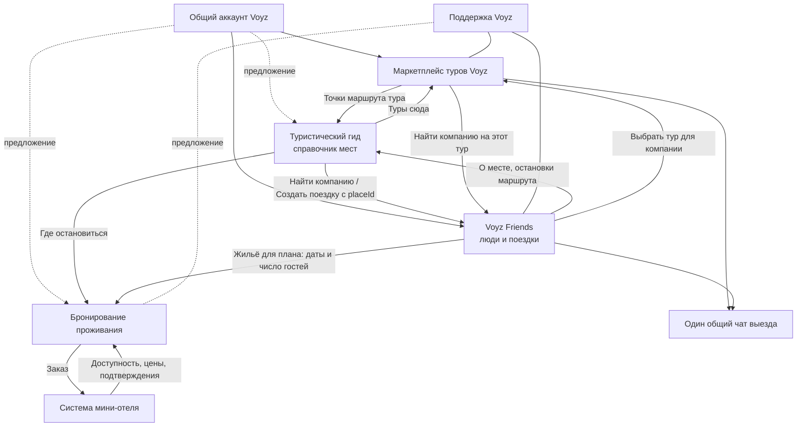

# Экосистема Voyz и Voyz Friends — продуктовая модель v0.2

Дата: 30 октября 2026 года (обновлено после сверки с репозиториями GitHub). Заменяет `voyz-friends-product-v1.md` (v0.1). Документ пересобран: сначала вся экосистема — продукты, функции и связи, затем подробно Voyz Friends.

Это продуктовая модель, не техническое задание и не описание архитектуры. Детальные правила интерфейса для разработки — в `Voyz-Friends-Codex-Specification.md`; при расхождении приоритет у последних прямых решений владельца продукта.

## Как читать документ

Каждое утверждение помечено статусом, чтобы предложения не выдавались за решения:

| Метка | Значение |
|---|---|
| **[С]** | Согласовано владельцем продукта |
| **[Ф]** | Факт со слов владельца о том, что уже работает |
| **[Н]** | Наблюдение по записи экрана прототипа гида (27.10.2026); не подтверждено как утверждённый функционал |
| **[Р]** | Проверено по коду и README репозиториев `volgintb-arch` 30.10.2026 (демо-версии, не данные о реальных клиентах) |
| **[П]** | Предложение для связности модели; можно изменить |
| **[?]** | Открытый вопрос; нужно решение до соответствующей части запуска |

Названия «Voyz Friends», «туристический гид», «бронирование проживания» и «система мини-отеля» — рабочие **[С]**.

---

# Часть I. Экосистема Voyz

## 1. Замысел

Экосистема сопровождает путешественника на всём пути **[П]**:

```text
узнать о месте → выбрать время и маршрут → найти компанию → выбрать формат
(самостоятельно или авторский тур) → забронировать нужные услуги → съездить
→ поделиться опытом → спланировать следующую поездку
```

Войти можно через любой продукт **[П]**. Каждый продукт полезен сам по себе и одновременно направляет пользователя в соседние, когда у него появляется следующая задача.

**Стратегия [С]:** сначала бесплатная полезность и выход на рынок, затем взаимный трафик между продуктами, затем монетизация. Платные функции не утверждены.

**Рынок [С]:** старт в Кыргызстане — местные жители и приезжие туристы; дальше международное развитие. По записи гида уже есть направления «Кыргызстан» (более 80 мест) и «Россия / Алтай» (более 29 мест) **[Н]**, то есть справочник мест изначально шире Кыргызстана.

## 2. Состав экосистемы

| Продукт | Статус | Для кого | Главная задача |
|---|---|---|---|
| **Маркетплейс авторских туров Voyz** | Работает, iOS и Android **[Ф]** | Путешественники и организаторы туров | Выбрать, забронировать и оплатить конкретный выезд тура |
| **Туристический гид** (`voyz-app`) | Есть приложение и веб-демо **[Р]** | Путешественники | 112 мест (83 в Кыргызстане, 29 на Алтае): как добраться, где оставить машину и ночевать, сезон, аудиогид, работа без интернета |
| **Voyz Friends** (`voyz-friends-app`) | Есть приложение React Native и веб-демо **[Р]** | Путешественники 18+ | Найти людей и собрать компанию для поездки |
| **Voyz Booking — гостям** (`voyz-booking`) | Есть приложение, сервер и веб-демо **[Р]** | Путешественники | Найти юрту или гостевой дом на даты и забронировать с предоплатой хозяину |
| **Voyz Booking — хозяевам** (тот же `voyz-booking`) | Есть приложение и сервер **[Р]** | Хозяева гостевых домов и юрточных лагерей | Шахматка, брони из WhatsApp и звонков, подтверждение оплат, календари Booking.com/Airbnb, передача в учёт Aynes. Это и есть замысел «мини TravelLine» |
| **Поддержка Voyz** | Работает **[Ф]** | Все пользователи | Обращения, жалобы, обжалования |

Размещение продуктов по приложениям **[?]**: гид, бронирование жилья и Friends могут быть разделами одного приложения или отдельными приложениями. Сейчас согласовано только, что Friends — отдельное приложение **[С]**. В записи гида в нижней панели есть переход «‹ VOYZ» **[Н]** — вероятно, гид живёт рядом с маршрутом в основное приложение.


## 2.1. Что показали репозитории (30.10.2026) [Р]

| Репозиторий | Что это | Демо по ссылке |
|---|---|---|
| `volgintb-arch/voyz-app` | Путеводитель Voyz (Expo SDK 57): 112 мест, офлайн-карта, аудиогид, «Хочу сюда», без авторизации — всё хранится на устройстве | https://volgintb-arch.github.io/voyz-app/ |
| `volgintb-arch/voyz-friends-app` | Voyz Friends (Expo SDK 58, React Native): люди, поездки, заявки, резерв, чаты, выбор автора, демо-сценарии | https://volgintb-arch.github.io/voyz-friends-app/ |
| `volgintb-arch/voyz-booking` | Бронирование юрт и гостевых домов: гостевая часть и кабинет хозяина, сервер, предоплата по QR хозяина, Telegram-бот, iCal, учёт в Aynes, ru/ky/en | https://volgintb-arch.github.io/voyz-booking/ |

Что это меняет в модели:
- **Жильё и система мини-отеля — один продукт Voyz Booking** с двумя сторонами (гость и хозяин). Источник истины по занятости и ценам — сервер Booking; двойная продажа запрещена на уровне базы. Деньги идут хозяину напрямую (QR, перевод, наличные), брони и оплаты уходят в учёт Aynes.
- **Справочник мест уже существует** — `places.json` гида с устойчивыми id (`kg-son-kul`, `kg-0003` — Ала-Арча, `kg-0039` — Иссык-Куль…). Friends ссылается на них полем `guidePlaceId`.
- **Связи уже есть в демо:** из поездки Friends кнопка «Место в Voyz Guide» открывает карточку места (`/voyz-app/place/<id>`), «Где остановиться» — поиск жилья в Voyz Booking. Адресная ссылка на объект Booking (`#/guest/p/<slug>?in=&out=&g=&src=`) поддержана кодом, но в публичном демо Booking объектов из seed нет — поэтому пока ведём в поиск.
- **Аккаунты разные:** гид работает без входа, Booking — вход хозяина через Telegram, Friends — демо-вход. Общий аккаунт Voyz остаётся целью **[?]**.
- Стек разный: гид и Friends — Expo/React Native, Booking — React + Vite + Capacitor. Общие пакеты (токены, справочник мест, ссылки) пока не выделены **[П]**.

## 3. Продукты подробно

### 3.1. Маркетплейс авторских туров Voyz

**Что уже есть [Ф]:** вход по телефону; личные профили; каталог авторских туров; конкретные выезды (даты); бронирование выезда; онлайн-оплата; переписка с организатором; групповые чаты.

**Роль в экосистеме:**
- Источник истины для тура, выезда, цены, наличия мест, условий оплаты и отмены, статуса бронирования **[С]**.
- Отдаёт туры в Friends с пометкой организатора — чтобы люди могли искать компанию до покупки **[С]**.
- Держит **один общий чат забронировавших конкретный выезд**, доступный и из Voyz, и из Friends; сообщения одни и те же **[С]**. Технический способ не проверен **[?]**.
- Принимает переходы из гида («подходящие туры для этого места») **[П]**.

**Что не делает:** не управляет самостоятельными поездками Friends, не знает о резервах и заявках Friends **[С]**.

### 3.2. Туристический гид

**Назначение [Ф]:** практическая информация о конкретных местах — как добраться, где припарковаться, когда посещать, где жить и другие детали.

**Что видно в записи прототипа [Н]:**
- Стартовый экран «С чего начнём?» с двумя путями: **«Исследовать»** — места и самостоятельные маршруты; **«Путешествовать»** — туры с гидами.
- «Куда едем?» — выбор направления (страна или регион) с поиском «Что исследуем?», фильтрами и переходом на карту.
- Страница направления с подборками: «Сейчас самое время» (сезонность), «Лучше всего изучено», «Можно без машины», «Недалеко от <города>», «Все места»; категории (озёра, история и культура, перевалы…).
- Карточки мест с регионом и отметкой «избранное» (сердце).
- Нижняя навигация: поиск, карта, маршруты, ещё одна вкладка, переход в Voyz.

**Роль в экосистеме [П]:**
- Владелец **общего справочника мест** с устойчивыми идентификаторами: один объект «Сон-Куль» для гида, поездок Friends, туров и проживания. Не копировать несинхронные карточки мест в каждый продукт.
- Главная точка входа по интересу: человек выбирает место, а уже потом решает, с кем и как туда ехать.
- Отдаёт трафик: в Friends («Найти компанию», «Создать поездку»), в маркетплейс («Туры сюда»), в проживание («Где остановиться»).
- Принимает трафик: из поездки Friends — «О месте», из тура — описание точек маршрута.

**Чего гид не делает:** не создаёт бронирований и не управляет группами. «Хочу сюда» / «в избранном» в гиде — это интерес, а не участие в поездке **[П]**.

### 3.3. Voyz Friends

Поиск попутчиков и друзей, самостоятельные поездки, компания на авторский тур. Отдельное приложение с общим аккаунтом Voyz **[С]**. Подробно — в части II.

### 3.4. Бронирование проживания

**Назначение [Ф]:** прямое бронирование жилья. Реализуется в Voyz Booking — см. раздел 2.1 **[Р]**.

**Предлагаемая цепочка [П]:** место или план поездки → даты, число гостей и требования → подходящие объекты → актуальная доступность → подтверждённый заказ → обработка объектом.

**Связи [П]:** вход из гида (жильё рядом с местом) и из плана Friends (даты и состав группы как подсказка); передача заказа в систему мини-отеля; получение доступности, цен и подтверждений.

**Принципиально:** групповой резерв места в Friends — не гостиничный резерв; согласие группы само по себе не создаёт заказ **[П]**. Каждый бронирует сам или один человек бронирует на свои данные — правила **[?]**.

### 3.5. Система мини-отеля

**Назначение [Ф]:** административный кабинет объекта размещения. Реализуется хозяйской частью Voyz Booking — см. раздел 2.1 **[Р]**.

**Предполагаемые разделы [П]:** номерной фонд; занятость и календарь; заявки и бронирования; гости; статусы заезда и выезда. Тарифы, платежи, архитектура и точный функционал не утверждены **[?]**.

**Связи [П]:** отдаёт в бронирование доступность и подтверждения; принимает бронирования из экосистемы. Нужно определить, кто источник истины по остаткам, ценам и отменам, и как исключить двойную продажу **[?]**.

### 3.6. Общая платформа

| Слой | Решение |
|---|---|
| **Аккаунт** | Общий вход для Voyz и Friends по телефону; общие поля — имя, возраст, телефон **[С]**. Распространение на гид, проживание и кабинет отеля **[П]**. |
| **Проверки** | Телефон подтверждается, фото проверяется; документы — позже **[С]**. Переиспользование проверок между продуктами — только при совместимом способе **[С]**, технически не проверено **[?]**. |
| **Справочник мест** | Общий, принадлежит гиду **[П]**. |
| **Чаты** | Чат с организатором и групповые чаты Voyz **[Ф]**; общий чат выезда Voyz ↔ Friends **[С]**; личные и групповые чаты Friends **[С]**. |
| **Поддержка** | Команда Voyz уже есть и принимает обращения Friends **[Ф]/[С]**. Процессы для жилья и отелей — **[?]**. |
| **Уведомления** | Одно событие не должно приходить дважды из двух приложений **[С]** (для общего чата выезда). Способ дедупликации **[?]**. |
| **Прямые ссылки** | На место, поездку, тур, выезд, объект жилья; после входа — возврат к объекту; запасной путь, если приложение не установлено, **[?]** **[П]**. |
| **Платежи** | Только в маркетплейсе туров и (в будущем) в бронировании жилья. В Friends сбора денег, переводов и возвратов нет **[С]**. |

**Общий аккаунт ≠ общий доступ к данным [С].** Покупки, бронирования, сохранённые места и социальная анкета видны только тем продуктам и людям, которым это нужно и разрешено.

## 4. Карта связей



Связи Friends ↔ туры и общий чат выезда — согласованы **[С]**. Связи с гидом, проживанием и системой отеля — целевая модель **[П]**, готовность обмена данными не проверена.

## 5. Матрица обмена: кто что кому передаёт

| Откуда → куда | Что передаётся | Чего НЕ передаётся | Статус |
|---|---|---|---|
| Аккаунт → все | ID пользователя, имя, возраст, подтверждённость телефона | Телефон в публичные профили, фамилия, дата рождения | **[С]** для Voyz/Friends |
| Гид → Friends | `placeId`, название на 3 языках, регион, примерные координаты, ссылка на карточку | Непроверенные утверждения о дороге и сезоне в карточках поездок | **[П]** |
| Friends → гид | Переход к месту с адресом возврата | Состав группы, анкеты | **[П]** |
| Гид → маркетплейс | Место для подбора туров | — | **[П]** |
| Маркетплейс → Friends | Тур, выезд, организатор, ссылка; факт брони для допуска в чат выезда | Цена и остатки как «вечная» копия; детали оплаты | **[С]** (туры и чат) |
| Friends → маркетплейс | Переход к тому же туру и выезду | Группа Friends не бронирует за участников | **[С]** |
| Гид / Friends → проживание | Место, даты, число гостей как подсказка | Резерв Friends как гостиничный резерв | **[П]** |
| Проживание ↔ мини-отель | Заказы ↔ доступность, цены, подтверждения | — | **[П]**, источник истины **[?]** |
| Любой продукт → поддержка | Обращение, объект, ID поездки/брони в рамках полномочий | Переписка, к которой у заявителя нет доступа, не требуется | **[С]** для Friends |

## 6. Сквозные сценарии

**1. От места к самостоятельной поездке [П].** Карточка Сон-Куля в гиде → «Создать поездку» (место подставлено) → набор компании в Friends → согласование дат и бюджета → «Где остановиться» → каждый (или договорившийся) бронирует юрточный лагерь в проживании → заказ получает объект. Доступность и сезон проверяются при бронировании, а не в Friends.

**2. От места к компании без своей поездки [П].** Карточка места → «Найти компанию» → лента людей, которые указали это направление и включили «Ищу компанию» → личный запрос → совместный план.

**3. От знакомства к авторскому туру [С].** Люди находят друг друга в Friends → выбирают тур Voyz → каждый сам покупает его в Voyz → после подтверждённой брони попадает в общий чат выезда в обоих приложениях. Одобрение в компанию не резервирует место в туре.

**4. От тура к компании [С].** Человек смотрит тур в Voyz → «Найти компанию на этот тур» → поиск в Friends → возврат в тот же тур и выезд → покупка. Изменившиеся цена и наличие показываются перед покупкой в Voyz.

**5. От купленного тура к дружбе [С].** Бронь выезда → общий чат с другими участниками → по желанию включение анкеты Friends → новые поездки. Покупка сама не делает анкету публичной.

**6. От жилья к досугу [П].** После выбора жилья — места рядом в гиде и подходящие поездки в Friends. Объект, даты брони и точная геолокация не раскрываются другим людям без отдельного решения пользователя.

**7. После поездки [С]/[П].** Завершение → взаимное подтверждение совместного участия → отзыв → контакт сохраняется через уже принятый личный чат → новый план.

## 7. Сущности и разделение статусов

Эти сущности нельзя смешивать — у каждой свой владелец и свои правила **[С]/[П]**:

| Сущность | Владелец | Смысл |
|---|---|---|
| Аккаунт | Платформа Voyz | Один человек |
| Анкета путешественника | Friends | Социальные сведения с отдельной видимостью |
| Место | Гид | Объект справочника с `placeId` |
| Интерес к месту | Гид (с согласия — Friends) | «Хочу сюда», без обязательств и дат |
| Самостоятельная поездка | Friends | План, который создаёт пользователь |
| Заявка / резерв / участие | Friends | Шаги вступления в самостоятельную поездку |
| Тур / выезд / бронь тура | Маркетплейс | Коммерческое предложение и заказ |
| Бронь жилья | Бронирование проживания | Коммерческий заказ у объекта |
| Чат | Тот продукт, где он создан; чат выезда — общий | Тип определяет правила доступа |
| Жалоба / обращение | Поддержка Voyz | Не зависит от отзывов |
| Отзыв | Friends (для попутчиков) | Только после подтверждённой совместной поездки |

**Ключевые следствия [С]:** «Еду» в Friends, покупка тура и бронь жилья — разные действия с отдельными статусами. Выход из группы не отменяет оплаченный тур или жильё. Выход из чата не отменяет заказ. Изменение самостоятельной поездки не меняет коммерческую бронь.

**Совместный план [П]** связывает места, участников, туры и проживание и показывает группе договорённости и добровольно добавленные сведения. Это не общий платёж и не бронирование за всех.

## 8. Приватность в экосистеме

- Телефон, фамилия, дата рождения, точная геолокация, бронирования и оплата не публичны ни в одном социальном контексте **[С]**.
- Сохранённые места в гиде по умолчанию личные; в Friends они попадают только по явному согласию **[П]**.
- Покупатель жилья делится с группой только выбранными сведениями; номер комнаты, документы гостя и платёж не публикуются **[П]**.
- Статистика бронирований не становится публичной **[С]**.
- Уведомления не раскрывают на экране блокировки закрытую точку сбора и чувствительные данные **[П]**.

## 9. Трафик, монетизация и метрики

**Как продукты кормят друг друга [П]:** гид привлекает через полезную информацию о местах; Friends превращает интерес в компанию и возвращает людей на новые поездки; маркетплейс и проживание дают реализовать план; система отеля привлекает поставщиков, а с ними предложение жилья.

**Возможные доходы — не утверждены [С]:** комиссия с брони тура; комиссия или сервисный сбор за жильё; плата мини-отеля за систему; платные возможности для поставщиков; маркированное продвижение. В Friends платные сообщения, подписки и продвижение анкет не вводить без решения **[С]**.

**Показатели [П]:** переходы гид → создание поездки и гид → поиск людей; доля заявок, дошедших до «Еду»; переходы Friends → покупка тура и жилья; состоявшиеся поездки; повторное использование нескольких продуктов; дополнительная прибыль связанных сценариев за вычетом поддержки и модерации. Не приписывать Friends все покупки его пользователей — нужен анализ дополнительного эффекта.

## 10. Последовательность подключения [П]

| Этап | Что подключаем | Условие |
|---|---|---|
| 0 | Прототип Friends с локальными данными и адаптерами-заглушками (сделано) | — |
| 1 | Friends на аккаунтах, турах, бронях и чатах Voyz | Проверка API Voyz |
| 2 | Гид ↔ Friends: `placeId`, кнопки «Найти компанию», «Создать поездку», карточка «О месте» | Устойчивые ID мест в гиде |
| 3 | Интересы к местам и объяснимые совпадения в ленте Friends; маршруты из нескольких мест | Согласие пользователя на передачу интересов |
| 4 | Проживание и система отеля: доступность, бронирование, обработка объектом | Запуск гостиничного продукта |
| 5 | Выбор модели монетизации по данным | Накопленная статистика |

Разработка Friends не ждёт гостиничный продукт **[С]**.

## 11. Открытые вопросы экосистемы

1. Состав приложений: гид, жильё и Friends — одно приложение или несколько?
2. API и стек Voyz: аккаунты, каталог, брони, чаты.
3. Кто выдаёт `placeId`, стабилен ли он, нужен ли офлайн-кэш карточек.
4. Общий аккаунт для гида, жилья и кабинета отеля; роли персонала отеля.
5. Источник истины по остаткам, ценам и отменам жилья; защита от двойной продажи.
6. Единый чат выезда: техническая реализация, допуск (предоплата, полная оплата, ручное подтверждение), поведение при отмене брони.
7. Дедупликация уведомлений между приложениями.
8. Процессы поддержки для жилья и отелей; полномочия и сроки.
9. Юридические требования к персональным данным и платежам в Кыргызстане и следующих странах.
10. Бренд-материалы Voyz: логотип, шрифт, цвета (сейчас токены сняты с записи на глаз).

---

# Часть II. Voyz Friends

## 12. Назначение и границы

**Что это [С]:** приложение для поиска компании в путешествия и дружбы. Отдельное приложение, общий аккаунт Voyz, название с Voyz и оформление в стиле бренда.

**Для кого [С]:** жители Кыргызстана и приезжие туристы, только 18+.

**Не является [С]:** сервисом романтических знакомств; сервисом регулярного извоза (совместный транспорт может быть частью поездки); платёжной системой группы.

**Три сценария первой версии [С]:**
1. Собрать небольшую компанию на 1–3 дня.
2. Найти попутчиков для путешествия по Кыргызстану любой продолжительности.
3. Найти компанию на авторский тур Voyz.

Искать компанию можно и без созданного маршрута **[С]**.

**Языки [С]:** интерфейс на русском, кыргызском и английском; языки общения задаются в анкете отдельно от языка интерфейса.

## 13. Роли

Роль относится к конкретной поездке; один человек может быть автором одной, кандидатом в другой и участником третьей **[П]**.

| Действие | Гость без входа [П] | Анкета заполнена | Кандидат | Резерв | Участник | Автор | Поддержка |
|---|---|---|---|---|---|---|---|
| Смотреть публичную поездку | Да | Да | Да | Да | Да | Да | По полномочиям |
| Смотреть анкеты | Кратко | Да | Да | Да | Да | Да | По полномочиям |
| Подать заявку | Нет | Да | Одна активная | — | — | Не в свою | Нет |
| Групповой чат поездки | Нет | Нет | Нет | **Да [С]** | Да | Да | При служебной необходимости |
| Точная точка сбора | Нет | Нет | Нет | Да | Да | Да | По полномочиям |
| Подтвердить «Еду» | — | — | — | Да | Уже | — | — |
| Одобрять, исключать, менять условия | — | — | — | — | — | Да | Модерация отдельно |
| Пожаловаться | После входа | Да | Да | Да | Да | Да | Рассматривает |

Резерв даёт доступ к чату, но не считается окончательно едущим **[С]**. Автора нельзя исключить; он может только выйти со сменой автора **[С]**.

## 14. Вход, анкета и проверки

**Первый запуск [П]:** короткий экран «Найди компанию для путешествий по Кыргызстану» с двумя кнопками — «Смотреть поездки» и «Войти через Voyz». Без длинной презентации.

**Вход [С]:** через существующую систему Voyz по телефону.

**Обязательно для сообщений и заявок [С]:** имя, возраст, фото с лицом, город, языки общения, короткое описание, подтверждённый телефон, проверенное фото.

**Дополнительно по желанию [П]:** интересы, темп, комфорт, ранние подъёмы, курение и алкоголь, опыт, транспорт и готовность водить, направления и доступные даты, ориентир бюджета. Обязательными не делать без решения.

**Возраст [П]:** рассчитывается из даты рождения; дата рождения не публична; до 18 лет социальные функции недоступны (аккаунт Voyz при этом не удаляется).

**Общие и отдельные поля [С]:** имя, возраст и телефон — общие с Voyz (при изменении в Friends предупреждать о синхронизации **[П]**). Фото, описание, интересы и видимость — отдельные.

**Проверки [С]:** телефон подтверждается, фото проверяется; документы позже. Метод проверки фото не выбран **[?]**. У каждой проверки статусы: не начата, выполняется, успешно, повторить, отклонена, ошибка сервиса **[П]**. Показывать «Телефон подтверждён» и «Фото проверено», а не «безопасен»: отметки не гарантируют безопасность **[С]**.

## 15. Видимость и приватность

- Анкета попадает в поиск «Люди» только после явного включения **«Ищу компанию»**; конкретная поездка не нужна **[С]**.
- Выключение убирает из поиска, но не удаляет аккаунт, поездки и принятые чаты **[П]**.
- Анкета может оставаться видна через участие в публичной поездке даже при выключенном поиске **[П]**, **[?]**.
- **Публично [С]:** имя, возраст, город, языки, описание, интересы, отметки проверок.
- **Скрыто [С]:** телефон, фамилия из Voyz, точная геолокация, детали бронирований; дата рождения **[П]**.
- Точная точка сбора — только одобренным (включая резерв) **[С]**; публично — примерный район старта **[П]**.
- Публичные анкеты принятых участников видны до подачи заявки **[С]**; список ожидающих кандидатов — только автору **[П]**.
- Закрытие доступа к чату не удаляет сообщения у остальных **[С]**; скриншоты отозвать нельзя.

## 16. Поиск людей

**Режимы [С]:** основной — лента карточек; дополнительный — свайпы. Одинаковый состав и фильтры в обоих; у каждого жеста есть кнопка **[П]**.

**Свайпы [П]:** влево — пропустить, вправо — открыть форму запроса; ни один жест не отправляет сообщение без подтверждения. Пропуск не равен отказу на уже полученный запрос.

**Карточка [П]:** фото, имя и возраст, город (и «приезжий»), языки, 1–3 интереса, кратко о себе или план, отметки проверок, объяснение совпадения. Не показывать придуманный процент совместимости, «онлайн» или расстояние — писать конкретно: «Совпадают язык и даты», «Бюджет пока не указан».

**Фильтры [С]:** направление/место, даты, язык общения, возраст 18+, формат отдыха, бюджет с «обсудим», пол попутчиков. Город проживания и место встречи — разные поля; приезжие не исключаются.

**Правила фильтров [П]:** применяются кнопкой; есть сброс и счётчик условий; сохраняются при возврате из анкеты; пустая выдача предлагает изменить условия или создать поездку; фильтры молча не ослабляются. Неизвестные даты и бюджет не считаются совпавшими при строгом фильтре (опции «Показывать без дат», «Включая „обсудим“»).

**Связь с гидом [П]:** фильтр «направление» использует `placeId` из справочника гида; с согласия человека его сохранённые места дают объяснения вида «Вы оба хотите на Сон-Куль».

## 17. Личные запросы и сообщения

**Согласовано [С]:**
- Не более **пяти новых запросов незнакомым людям в сутки**.
- До принятия — **одно сообщение**.
- Получатель принимает или отклоняет; **после отказа повторный запрос невозможен**.
- После принятия общение свободное; лимит на принятые чаты не действует.

**Предложено [П]:** сутки по Asia/Bishkek с показом времени сброса; неуспешная отправка лимит не тратит; отозванный запрос лимит не возвращает; встречные запросы дают один чат после явного согласия; причина отказа не раскрывается. Срок жизни неотвеченного запроса **[?]** — не считать молчание отказом.

**Состояния запроса [П]:** можно отправить → отправлен → (принят | отклонён | отозван); а также входящий, заблокирован, недоступен, лимит исчерпан. Повторное нажатие не создаёт дубль.

**Блокировка [С]/[П]:** прекращает новые запросы и личные сообщения. В общей группе не удаляет никого из поездки; сообщения заблокированного можно скрыть у блокирующего с предложением обратиться в поддержку **[П]**, **[?]**.

## 18. Поездки: каталог

**Два типа [С]:** самостоятельные поездки (публикуют путешественники) и авторские туры Voyz (приходят из маркетплейса с пометкой организатора). Публиковать коммерческий тур из профиля Friends нельзя **[П]**.

**Карточка самостоятельной поездки [П]:** иллюстрация, место или маршрут, даты (точные или гибкое окно), длительность, примерный район старта, свободные места, состав компании, бюджет или «Обсудим вместе», автор и аватары подтверждённых.

**Карточка тура [С]/[П]:** организатор, конкретный выезд, цена и статус из Voyz. Места социальной компании не выдавать за свободные места тура.

**Фильтры [С]:** направление, даты, длительность, свободные места, язык, формат, бюджет, состав компании.

**Состояния каталога [П]:** загрузка, данные, нет совпадений, пока нет поездок, ошибка с повтором, офлайн с кэшем, предложение недоступно. Возврат сохраняет фильтры и прокрутку.

**Связь с гидом [П]:** круглые подборки мест в каталоге берутся из гида; у каждой поездки кнопка «О месте» с живой карточкой гида и датой обновления.

## 19. Создание самостоятельной поездки

Создаёт путешественник с заполненной и проверенной анкетой **[С]**.

**Обязательно [С]:** место или маршрут по Кыргызстану; точные или примерные даты; длительность; точка встречи (публично — район, точно — после одобрения); количество свободных мест; описание; примерный бюджет на человека или «Обсудим вместе».

**Автор выбирает [С]:** женскую, мужскую или смешанную компанию. Возраст и подготовка — пожелания, не условия. До трёх вопросов к заявке.

**По желанию [П]:** фото, остановки маршрута, транспорт, формат жилья, включённые расходы, опыт, что взять.

**Мастер из трёх шагов [П]:** «Куда и когда» → «Компания и условия» → «Описание и публикация» с предпросмотром. Черновик сохраняется; ошибки показываются у полей и сводкой; введённое не теряется.

**Правила проверки [П]:** места 1–20 (приглашённые, автор отдельно); бюджет неотрицательный, «от» ≤ «до»; конец не раньше начала; прошедшие даты не публикуются; при гибком окне длительность не больше окна.

**Из гида [П]:** «Создать поездку» в карточке места подставляет `placeId`; маршрут из нескольких мест — упорядоченный список остановок. Доступность дороги, парковки и сезона не придумывается.

## 20. Экран поездки и действия по ролям

Сверху фото и главное, далее автор, маршрут, условия, бюджет, состав, публичные анкеты принятых, пожелания, действие по роли **[П]**.

| Роль / состояние | Основное действие |
|---|---|
| Гость | Войти, чтобы подать заявку |
| Подходящая анкета | Подать заявку |
| Неполная анкета | Завершить профиль с возвратом в поездку |
| Заявка ждёт | Статус, отозвать |
| Резерв | «Еду» со сроком, чат, отказаться |
| Участник | Чат, условия, выйти |
| Автор | Заявки, участники, изменить условия, закрыть/возобновить набор, выйти со сменой автора |
| Набор закрыт / мест нет | Объяснение и альтернативы |
| Исключён | Причина, обращение в поддержку, без чата |

Резерв визуально не смешивается с подтверждённым участием **[П]**.

## 21. Заявка, резерв и «Еду»

**Заявка [С]:** каждый взрослый подаёт сам, за себя; сообщение, согласие с текущими условиями, ответы на вопросы автора (до трёх). Без групповых, детских и анонимных заявок **[П]**. Одна активная заявка в поездку **[П]**.

**Последовательность [С]:**
1. Заявка отправлена.
2. Автор одобряет или отклоняет (без оплаты).
3. Одобрение → **резерв места на 24 часа**, но не позднее старта.
4. **Сразу открываются групповой чат и точная точка сбора.**
5. Участник нажимает **«Еду»** → резерв становится занятым местом.
6. Нет «Еду» к сроку → место освобождается, **вся переписка группы, включая историю, становится недоступна**. Роли гостя нет. Вернуться — только новой заявкой и новым одобрением.

**Защита мест [С]:** одно место не выдаётся двоим; при одновременных одобрениях поездка не переполняется. Повторное одобрение той же заявки не создаёт второй резерв **[П]**.

**Учёт мест [П]:** вместимость ≥ подтверждённые + активные резервы; свободно = вместимость − подтверждённые − резервы; ожидающие заявки места не занимают; автор считается отдельно.

**Время [П]:** срок резерва задаёт сервер, а не часы телефона; смена часового пояса устройства срок не продлевает.

**Гибкие даты [?]:** граница резерва — ближайшее начало окна **[П]**; перед выездом группа подтверждает точную дату.

**Состояния участия:**

| Состояние | Место | Чат | Дальше |
|---|---|---|---|
| На рассмотрении | Не занято | Нет | Решение или отзыв |
| Отклонена | Не занято | Нет | Повтор не согласован **[?]** |
| Резерв | Временно | Да | «Еду», отказ, истечение |
| Участие подтверждено | Занято | Да | Поездка, изменения, выход |
| Отозвана | Не занято | Нет | Новая заявка **[П]** |
| Резерв истёк **[С]** | Свободно | Нет, вся история | Новая заявка |
| Вышел сам **[С]** | Свободно | Нет, вся история | Новая заявка |
| Исключён **[С]** | Свободно | Нет, вся история | Обжалование |
| Отказ от новых условий / молчание **[С]** | Свободно | Нет, вся история | Новая заявка |

## 22. Жизненный цикл поездки

**Статусы [П]:** черновик → набор открыт → набор закрыт → идёт → завершена; отдельно — отменена. Параллельные процессы (ждём подтверждения изменений, выбираем автора, модерационное ограничение) хранятся отдельно и не стирают основной статус.

- Автор закрывает набор без отмены поездки и без закрытия чата принятым; возобновляет до старта при наличии мест **[П]**.
- После старта заявки закрыты **[П]**.
- После завершения — подтверждение совместного участия и отзывы **[С]**.
- Отмена не отменяет туры и жильё **[С]**; чат на время урегулирования только для чтения **[П]**, **[?]**.

## 23. Изменение условий

**Согласовано [С]:** существенное изменение дат, маршрута или бюджета требует повторного подтверждения; срок **24 часа, но не позднее нового старта**; до ответа место сохраняется; отказ или молчание → участие прекращается, место освобождается, переписка закрывается.

**Предложено [П]:** существенным считается любое изменение дат или окна, основного направления или обязательной остановки, диапазона бюджета, смена «обсудим» на сумму, смена валюты. Опечатки и новая фотография подтверждения не требуют. Каждая версия условий хранится; на экране «Было → Стало», автор изменения и срок; согласие привязано к версии. Перенос в прошлое запрещён. Автор сначала видит предпросмотр изменений.

**Открыто [?]:** точка встречи, транспорт и состав как повод для подтверждения; несколько изменений подряд; сочетание срока резерва и срока подтверждения.

## 24. Выход, исключение и смена автора

**Выход [С]:** место освобождается, вся переписка недоступна; вернуться — новой заявкой. Перед выходом показать последствия, включая то, что брони туров и жилья не отменяются **[П]**.

**Исключение [С]:** автор указывает причину; причина доступна исключённому отдельно от чата; обжалование — в поддержке Voyz; жалобы на автора рассматривает поддержка, а не автор. Сообщения исключённого у остальных не удаляются **[П]**.

**Смена автора [С]:** при выходе автора группа выбирает нового: выдвижение, голосование **48 часов**, кандидат с большинством голосов принимает роль, при равенстве — **второй тур**; пока идёт выбор, **новые заявки приостановлены**; если никто не согласился — **поездка отменяется**.

**Детали [П] (требуют утверждения):** голосуют только подтверждённые участники на момент открытия; один голос, можно менять; кандидат выдвигается сам, значит согласен; второй тур — 24 часа между лидерами; повторная ничья или отказ победителя → поддержка; конфликт с близким стартом — показать и направить в поддержку; ожидающие заявки ждут, резервы живут по своим срокам. Кворум и смысл «большинства» **[?]**.

## 25. Чаты

| Тип | Кто | Когда открыт |
|---|---|---|
| Личный | Двое | После принятия запроса **[С]** |
| Групповой чат самостоятельной поездки | Автор, участники, резервы | С момента одобрения **[С]** |
| Общий чат выезда тура | Подтверждённые покупатели выезда | После брони в Voyz; один чат в Voyz и Friends **[С]** |

**В первой версии [П]:** только текст. Вложения, голосовые, звонки, редактирование и удаление — позже; не показывать как неработающие кнопки.

**Над перепиской поездки [П]:** статус поездки, условия, срок резерва и кнопка «Еду» для неподтверждённых.

**Системные сообщения [П]:** принят, подтвердил, вышел; условия изменились; набор закрыт; выбор автора; отменена; завершена. Подробности чужих жалоб и оплат в группе не раскрываются.

**Права [П]:** сервер проверяет доступ к истории, новым сообщениям, вложениям и подпискам — недостаточно спрятать чат в интерфейсе. После повторного вступления история показывается с нового одобрения **[П]**, **[?]**.

## 26. Авторские туры внутри Friends

**[С]:** два раздельных пространства — компания до покупки и чат забронировавших выезд. Тур покупается только в Voyz; резерв в самостоятельной поездке не заменяет бронь тура; источник мест и статусов — Voyz.

**[П]:** до покупки можно сохранить социальный план «еду на этот тур, если найдётся компания» — это не бронь и не блокировка места. Кнопка «Открыть в Voyz» ведёт к тому же туру и выезду. Отмена брони, перенос, возврат или снятие тура обновляют статус в Friends. Правила истории чата выезда согласуются с Voyz отдельно — правила самостоятельных поездок на него не переносятся.

**[?]:** кто допускается в чат выезда — предоплата, полная оплата или ручное подтверждение; нужно взять реальную политику Voyz.

## 27. Связь Friends с туристическим гидом [П]

| Точка | Что происходит |
|---|---|
| Карточка места → «Найти компанию» | Friends открывает «Люди» с фильтром по `placeId` |
| Карточка места → «Создать поездку» | Мастер Friends с подставленным местом и адресом возврата |
| Карточка места → «Хочу сюда» | Интерес без дат; не делает человека участником |
| План из нескольких мест в гиде | Поездка Friends с упорядоченными остановками |
| Поездка Friends → «О месте» | Живая карточка гида: как добраться, парковка, сезон, дата обновления |
| Гид пометил место/маршрут недоступным | Предупреждение в поездке; без автоматической отмены |
| Подборки «Сейчас самое время», «Можно без машины» **[Н]** | Могут стать подборками поездок Friends по тем же местам |

**Контракт:** `PlaceRef { placeId, names{ru,ky,en}, region, centroid (приблизительно), deepLink, updatedAt }` и `Interest { userId, placeId, dateWindow?, visibleToFriends }`.

**Приватность:** сохранённые места передаются в Friends только по явному согласию, отдельно от «Ищу компанию»; совпадения по интересам видят только люди с включённой видимостью; точная геолокация не передаётся.

## 28. Проживание из Friends [П]

Из поездки — «Найти жильё» с подсказками: место, даты, число участников. Каждый бронирует по правилам сервиса проживания. Групповая договорённость не создаёт заказ; выход участника из компании не меняет чужую бронь; с группой человек делится только выбранными сведениями.

## 29. Отзывы, жалобы и поддержка

**Отзывы [С]:** после завершения и **взаимного** подтверждения совместного участия.

**Механика [П]:** выбрать, с кем действительно ехали → вторая сторона подтверждает → отзыв доступен для пары; оценка 1–5 и текст; публикация после ответа второй стороны или через 14 дней, только при подтверждённом участии; без отзывов средний рейтинг не показывается; автор не подтверждает за всех.

**Жалобы [С]:** в любое время, без согласия второй стороны; блокировка предусмотрена. Отзыв не единственный способ сообщить о нарушении.

**Поддержка [С]:** поддержка Voyz принимает жалобы и обжалования Friends. Жалобы доступны из анкеты, поездки, чата, сообщения, а после потери чата — из экрана статуса и профиля **[П]**. Категории **[П]:** спам, мошенничество, нежелательные знакомства и домогательства, оскорбления и угрозы, ложная информация, нарушение условий поездки, другое. Не обещать круглосуточную или экстренную помощь без такой возможности.

**Кабинет поддержки [П]:** очередь, категории, связанный объект, история решений, комментарии, ограничение нарушителя, восстановление доступа, журнал действий.

## 30. Уведомления [П]

События: входящий запрос и его принятие; новая заявка автору; одобрение и отказ; создание резерва и напоминание; подтверждение; истечение; изменение условий; выбор автора; исключение; отмена и завершение; новое сообщение; ответ поддержки; статус брони Voyz.

Напоминание за 2 часа до конца резерва; неактуальные напоминания не отправлять; уведомление ведёт в текущее состояние объекта. Настройки сообщений и поездок раздельные. Экран блокировки не показывает точку сбора.

## 31. Навигация и экраны [П]

Нижнее меню: **Люди · Поездки · Мои планы · Сообщения · Профиль** (на широком экране — боковое).

| Код | Экран |
|---|---|
| A01–A03 | Введение, анкета, проверки |
| P01–P04 | Лента и свайпы, анкета человека, новый и входящий запрос |
| T01–T12 | Каталог, фильтры, поездка, заявка, создание, заявки автору, резерв, участники, изменение условий, выход и исключение, смена автора, завершение и отзыв |
| M01 | Мои планы: участвую, мои заявки, организую, архив |
| C01–C04 | Сообщения, личный чат, чат поездки, чат выезда Voyz |
| U01–U03 | Профиль, настройки, уведомления |
| S01 | Обращение в поддержку |
| E01–E03 | Тур Voyz, место гида, проживание |

## 32. Визуальный стиль [П]

По записи гида: чёрная верхняя зона, белая поверхность с крупным верхним скруглением (32–38 px), лаймовый акцент около `#D5FF00` с чёрным текстом, фотокарточки 24–28 px со скруглением и затемнением под текст, круглые подборки мест, строка поиска с нижней линией, плавающая полупрозрачная нижняя навигация. Это приближение по записи, а не брендбук. Телефон — приоритет; кнопки от 44 px; видимый фокус; нельзя полагаться только на цвет или жест.

## 33. Время, валюта, данные

- Время отображается по месту старта (Кыргызстан — Asia/Bishkek), хранится в UTC; гибкие периоды хранятся отдельно **[П]**.
- Основная валюта примеров — KGS; бюджет — ориентир, не платёж; без автоконвертации **[П]**.
- Расчёты группа ведёт сама; сбор денег, переводы и возвраты в Friends на запуске не предусмотрены **[С]**.

**Логическая модель [П]:** `AccountRef`, `TravelerProfile`, `PlaceRef`, `Interest`, `Trip`, `Application`, `Membership`, `TermsChange`, `Election`, `Conversation`, `Message`, `BookingRef`, `Complaint`, `Review`, `Notification`. Цена тура и остатки жилья не копируются в план как вечная истина.

**Адаптеры будущих связей [П]:** аккаунт и профиль Voyz; туры и выезды; брони и допуск в чат; единая переписка; места гида; проживание; поддержка; уведомления.

## 34. Текущее состояние Friends

Интерактивный прототип (HTML/CSS/JS, локальные данные) реализует ключевые сценарии: вход и анкету, ленту и свайпы с фильтрами, личные запросы с лимитом, каталог и экран поездки по ролям, заявку, одобрение, резерв, «Еду», истечение, изменение условий, выход, исключение, выбор автора, завершение и отзыв, мастер создания, информационные переходы в Voyz, гид и проживание, панель демо-сценариев. Ограничения: только русский; иллюстрации-заглушки; связи с гидом и Voyz — заглушки, не выделенные в отдельный слой.

## 35. Открытые вопросы Friends

1. Метод проверки фото и переиспользование проверок Voyz.
2. Просмотр без входа; видимость анкеты через поездку при выключенном поиске.
3. Срок жизни неотвеченного личного запроса.
4. Повторная заявка после отказа или исключения.
5. Точная дата гибкой поездки и таймеры до её выбора.
6. Сочетание срока резерва и срока подтверждения изменений.
7. Порог существенности изменений вне дат, маршрута и бюджета.
8. Выбор автора: кворум, «большинство», близкий старт, спорные итоги.
9. Блокировка внутри общей группы.
10. История чата после повторного вступления, отмены и завершения; сроки хранения.
11. Публикация отзывов, сроки и обжалование.
12. Допуск в чат выезда и его поведение при отмене брони.
13. Передача интересов из гида в Friends и правила согласия.
14. Окончательное название и бренд-материалы.
