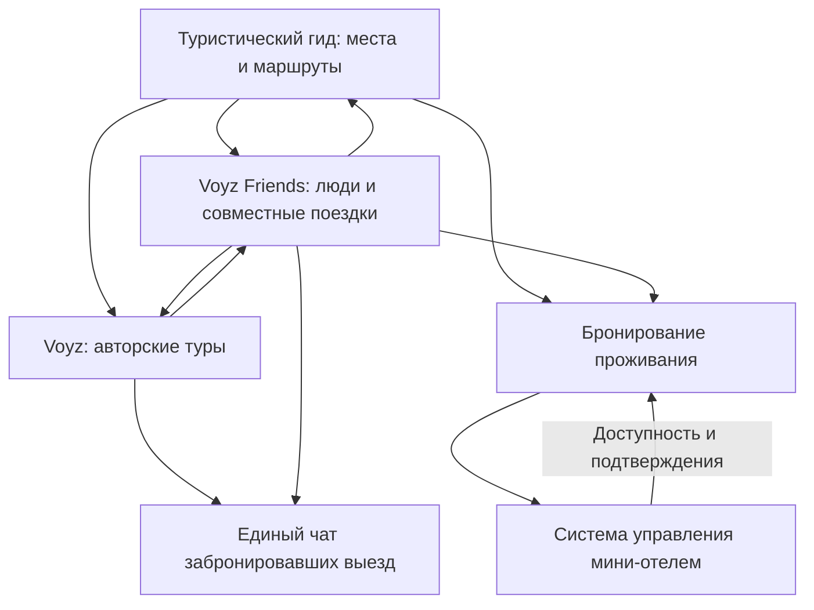

# Voyz Friends — продуктовая модель v0.1

Дата: 30 октября 2026 года. Voyz Friends — рабочее название; окончательное название не выбрано.

Полная спецификация для Codex и разработчиков вынесена в [Voyz-Friends-Codex-Specification.md](specification.md). Этот файл сохраняется как краткая продуктовая модель.

Документ фиксирует согласованные решения. Предложения и открытые вопросы отмечены отдельно. Это продуктовая модель, не готовое техническое задание.

## Контекст и цель

Voyz — работающий маркетплейс авторских туров в приложениях iOS и Android. Туристический гид разрабатывается: информация о местах, проезде, парковке, сезонах, проживании и других условиях посещения. В планах — прямое бронирование проживания и система управления для мини-отелей.

Новое приложение помогает найти компанию для путешествий и дружбы. Это отдельное приложение с общим аккаунтом Voyz, названием с Voyz и оформлением в стиле бренда. Романтические знакомства не входят в назначение продукта.

Первый рынок — Кыргызстан, местные жители и приезжие туристы. Дальнейшее направление — международный рынок. На запуске возраст 18+, интерфейс на русском, кыргызском и английском; языки общения задаются отдельно.

Пользовательская стратегия экосистемы — сначала бесплатные продукты, взаимный трафик, последующая монетизация. Платные функции нового приложения пока не утверждены.

## Связка экосистемы Voyz

### Общая модель

Экосистема сопровождает путешественника от знакомства с местом до организации поездки: узнать о месте → выбрать время и маршрут → найти компанию → выбрать самостоятельный формат или авторский тур → забронировать необходимые услуги → совершить поездку → поделиться опытом и спланировать следующую.

Вход возможен через любой продукт. Поиск попутчиков помогает превратить интерес в совместный план, туристический гид помогает выбрать места, маркетплейс предоставляет готовые путешествия, бронирование проживания позволяет организовать самостоятельную поездку. Система мини-отеля обслуживает поступившие бронирования со стороны объекта размещения.

### Продукты и их роли

| Продукт | Статус со слов пользователя | Роль | Связь с другими продуктами |
|---|---|---|---|
| Маркетплейс авторских туров Voyz, iOS и Android | Работает | Выбор и бронирование конкретного выезда, оплата, общение с организатором | Передаёт туры в поиск компании, связывает покупку с общим чатом выезда |
| Туристический гид | Разрабатывается | Информация о конкретном месте: как проехать, где припарковаться и пожить, когда ехать и другие детали | Предлагаемая связь: из места перейти к попутчикам, поездкам, подходящим турам и проживанию |
| Voyz Friends — рабочее название | Проектируется | Поиск попутчиков и друзей, самостоятельные поездки, компания на авторский тур | Общий аккаунт с Voyz, предложения туров и единый чат забронировавших выезд; в перспективе — места гида и проживание |
| Прямое бронирование проживания | В планах | Выбор доступного проживания и создание бронирования у объекта | Предлагаемая связь: доступ из гида и плана поездки; передача бронирования в систему объекта |
| Система управления мини-отелем | В планах | Административный кабинет для организации работы объекта и обработки бронирований | Предлагаемая связь: передаёт доступность проживания и принимает бронирования из экосистемы; точный состав внутренних функций ещё не определён |

Название туристического гида, бронирования и гостиничной системы, их размещение по приложениям и техническая архитектура пока не утверждены. «Мини TravelLine» — описание замысла гостиничного продукта, а не выбранный поставщик или подтверждённая интеграция.

### Карта связей

Схема описывает продуктовую связь. Связь Friends с турами и единый чат согласованы. Связи с гидом, проживанием и гостиничной системой — предлагаемая целевая модель; готовность обмена данными ещё не проверена.

### Сквозные сценарии

**От интереса к самостоятельной поездке.** Пользователь изучает место в гиде → создаёт поездку с привязкой к месту → собирает участников в Friends → согласует даты и бюджет → выбирает проживание → бронирует его после согласия участников. Бронирование получает объект размещения. Пример: страница Сон-Куля → компания на выходные → выбор юрточного лагеря. Доступность и сезонность конкретного объекта проверяются при бронировании.

**От знакомства к авторскому туру.** Пользователь находит человека или компанию в Friends → участники выбирают предложение Voyz → каждый оформляет свою покупку → после подтверждения бронирования получает доступ к общему чату конкретного выезда в обоих приложениях. Одобрение заявки на знакомство не резервирует место в коммерческом туре.

**От купленного тура к общению.** Пользователь бронирует выезд в Voyz → знакомится с подтверждёнными участниками в общем чате → при желании активирует отдельную анкету Friends и находит компанию для следующих путешествий. Покупка тура сама по себе не включает публичную видимость анкеты.

**От проживания к планированию отдыха.** Предлагаемый сценарий: после выбора жилья человек смотрит места поблизости в гиде и подходящие поездки в Friends. Связь не раскрывает другим пользователям объект проживания, даты бронирования или точную геолокацию без отдельного решения пользователя.

### Общие данные и ответственность продуктов

| Данные | Согласованное решение или предложение |
|---|---|
| Аккаунт и основные поля | Согласовано для Voyz и Friends: общий вход, имя, возраст и телефон. Расширение на остальные продукты предлагается отдельно |
| Социальная анкета | Отдельная анкета Friends; видимость включается пользователем. Наличие аккаунта или покупки не делает анкету публичной |
| Проверки | Повторное использование возможно при совместимых способах проверки; требуется техническая проверка |
| Места | Предлагается общий справочник мест с устойчивыми идентификаторами для гида, маршрутов, туров и проживания, чтобы связывать один объект без дублирования |
| Совместная поездка | Friends управляет заявками, резервами, участниками, условиями и групповым чатом самостоятельной поездки |
| Коммерческий тур и выезд | Voyz остаётся источником условий, мест, оплаты и статуса бронирования конкретного выезда |
| Чат авторского выезда | Согласован один общий чат забронировавших, доступный из Voyz и Friends; сообщения не должны расходиться между приложениями |
| Проживание | Предлагается единая согласованная связь бронирования с доступностью объекта. Какой сервис окончательно подтверждает остатки, цены и отмены, нужно определить при проектировании |
| Поддержка | Команда поддержки Voyz уже есть. Она рассматривает обращения Friends; процессы для проживания и мини-отелей предстоит определить |

Для всех переходов предлагаются прямые ссылки на конкретное место, поездку, тур, выезд или объект проживания. После входа пользователь должен возвращаться к выбранному объекту. Если нужное приложение не установлено, запасной путь открытия ещё нужно спроектировать. Общий аккаунт не означает автоматический общий доступ ко всем данным.

### Совместный план и отдельные бронирования

Предлагается связывать места, участников, туры и проживание через совместный план поездки. Он показывает группе согласованные намерения и добровольно добавленные сведения. Это не единый платёж и не автоматическое бронирование за всех участников.

Принятие в самостоятельную поездку, подтверждение «Еду», покупка тура и бронирование проживания — разные действия с отдельными статусами. Выход из группы не отменяет автоматически оплаченный тур или жильё; отмена покупки проводится по правилам соответствующего сервиса. Подробности платежей и заказов доступны их владельцу и уполномоченной стороне, а не автоматически всем попутчикам.

### Трафик и будущая монетизация

Согласованная стратегия — бесплатная полезность продуктов на входе, взаимный трафик внутри экосистемы и последующая монетизация. Гид привлекает через информацию о местах; Friends помогает найти компанию и вернуться для новой поездки; маркетплейс и проживание позволяют реализовать совместные планы; гостиничная система обеспечивает работу поставщика.

Возможные, но ещё не утверждённые источники дохода: комиссия с бронирования тура, комиссия либо сервисный сбор за проживание, плата мини-отеля за систему управления, платные возможности для поставщиков и маркированное продвижение. Тарифы, плательщики и сроки введения оплаты пока не определены. Гарантированный рост трафика и дохода не предполагается — эффект связей проверяется на фактических действиях пользователей.

Предлагаемые показатели: переходы из гида в создание поездки; доля заявок, завершившихся подтверждённым участием; переходы из Friends в покупки туров и проживания; завершённые поездки; повторное использование нескольких продуктов; дополнительная прибыль от связанных сценариев с учётом поддержки и модерации. Для анализа нужны согласованные правила учёта переходов и доступа к данным; статистика бронирований не становится публичной.

### Последовательность подключения

1. Использовать работающие аккаунты, туры, бронирования и чаты Voyz для запуска Friends после проверки технических возможностей.
2. По мере готовности гида связать страницы мест с поиском людей, созданием поездки и подходящими турами.
3. После готовности проживания и системы объекта подключить поиск доступности, создание бронирования и его обработку объектом.
4. Проверить результат сквозных сценариев и выбрать модель монетизации на основе данных.

Это предлагаемая последовательность. Разработка Friends не обязана ждать запуска гостиничного продукта.

## Сценарии приложения Friends

1. Собрать небольшую компанию для поездки на 1–3 дня.
2. Найти одного или нескольких попутчиков для путешествия по Кыргызстану любой продолжительности.
3. Найти компанию на авторский тур из Voyz.

Есть два способа поиска: люди и поездки. Основная выдача людей — лента карточек; свайпы — дополнительный способ взаимодействия. Жест свайпа и его последствия пока не определены.

## Анкета и видимость

Перед отправкой сообщений и заявок обязательны имя, возраст, фото с лицом, город, языки общения и короткое описание. Телефон подтверждается, фото проверяется; документы добавляются позднее. Метод проверки фото пока не выбран.

Анкета появляется в поиске людей только после включения пользователем «Ищу компанию». Конкретная поездка для этого не обязательна.

Публично видны имя, возраст, город, языки, описание, интересы и конкретные отметки проверок. Телефон, фамилия из аккаунта Voyz, точная геолокация и детали бронирований скрыты. Точную точку сбора видят принятые участники.

## Общение

Личная переписка открывается после принятия запроса с одним сообщением. До принятия доступно только одно сообщение. Стартовый лимит — пять новых личных запросов в сутки. После отказа повторный запрос недоступен. В принятых чатах общение свободное.

Часовой пояс суточного лимита, срок действия запроса, обработка отсутствия ответа и правила отзыва запроса ещё не определены.

## Поиск

Фильтры: место или направление, даты, язык общения, возраст 18+, формат отдыха, бюджет с вариантом «обсудим», пол попутчиков. Для поездок также длительность и свободные места. Город проживания и место встречи — разные поля.

Автор самостоятельной поездки выбирает женскую, мужскую или смешанную компанию. Возраст и подготовка — пожелания, не жёсткие условия подачи заявки. Поведение фильтров при незаполненных необязательных полях ещё не определено.

## Самостоятельная поездка

При создании указываются место или маршрут по Кыргызстану, точные либо примерные даты, длительность, точка встречи, количество свободных мест и описание. Для примерного бюджета на человека разрешено «обсудим вместе».

Публичные анкеты принятых участников видны до подачи заявки. Чат, точная точка сбора и данные бронирований закрыты для посторонних.

Путешественники публикуют самостоятельные поездки. Коммерческие туры поступают из Voyz с пометкой организатора. Бюджет и договорённости видны группе; расчёты участники ведут самостоятельно. Сбор денег, переводы и возвраты внутри нового приложения на запуске не предусмотрены.

## Заявка и резерв места

Заявка содержит короткое сообщение, подтверждение ознакомления с текущими условиями и ответы на дополнительные вопросы автора — до трёх вопросов. Каждый взрослый подаёт заявку сам, со своего профиля.

Последовательность:

1. Участник отправляет заявку.
2. Автор рассматривает и принимает либо отклоняет её.
3. После одобрения место резервируется на 24 часа.
4. Если до старта меньше 24 часов, срок подтверждения ограничен временем старта.
5. Участник подтверждает участие — резерв становится занятым местом.
6. Если подтверждения нет до срока, место освобождается.

Статусы для дальнейшей детализации: на рассмотрении; отклонена; ожидает подтверждения участника; участие подтверждено; срок подтверждения истёк. Правила отмены заявки и выхода участника ещё нужно закрепить.

Согласовано: групповой чат открывается сразу после одобрения заявки автором, пока место ещё в резерве. Окончательное подтверждение участия не является условием первоначального доступа к чату. При резервировании необходимо исключить выдачу одного места нескольким людям.

Согласовано: при добровольном выходе участника место освобождается, вся переписка группы становится ему недоступна. Повторное вступление — через новую заявку. Недоступность переписки пользователю не означает удаление сообщений из группы; хранение и доступ поддержки нужно определить отдельно.

Согласовано с учётом последнего исправления пользователя: при истечении резерва без подтверждения «Еду» место освобождается, вся переписка группы становится человеку недоступна. Роль гостя не предусмотрена. Для возвращения нужна новая заявка и одобрение автора. Недоступность переписки пользователю не означает удаление сообщений у остальных участников.

## Изменения и смена автора

Существенные изменения дат, маршрута или бюджета требуют повторного подтверждения участников. Согласованный срок — 24 часа, но не позднее нового времени старта. До ответа место сохраняется. При отказе или отсутствии ответа участие прекращается, место освобождается, вся переписка группы становится недоступна. Порог существенности и обработка нескольких изменений подряд ещё не определены. Эти правила относятся к самостоятельным поездкам, не к отменам оплаченных туров Voyz.

При выходе автора остальные участники выбирают нового. Желающие выдвигаются, голосование идёт 48 часов, кандидат с большинством голосов принимает роль. При равенстве — второй тур. Пока идёт выбор, новые заявки приостановлены. Если никто не согласился, поездка отменяется.

Ещё требуется определить: кто голосует при неподтверждённом резерве; что означает большинство; срок второго тура; отсутствие голосов; близкий старт поездки; судьба уже отправленных заявок и резервов. Новый автор должен явно согласиться принять роль.

## Авторские туры Voyz

Два этапа: поиск компании до покупки и отдельный чат людей с подтверждённым бронированием конкретного выезда. Тур покупается в Voyz. Резерв самостоятельной поездки не заменяет бронирование тура.

Источником наличия мест и статуса бронирования должен быть Voyz. Пользователь подтвердил, что в Voyz уже есть вход по телефону, личные профили, переписка с организатором, групповые чаты, бронирование конкретного выезда и онлайн-оплата. Точные детали покупок не публикуются.

Согласовано: у конкретного выезда один общий чат забронировавших, доступный из Voyz и Voyz Friends. Сообщения должны отражаться в обоих приложениях. Техническая возможность и способ реализации ещё не проверены.

Согласовано: общие имя, возраст и телефон; отдельная анкета путешественника и отдельное включение видимости. Повторное использование проверок возможно при одинаковом способе проверки и поддержке в Voyz; это требует технического уточнения.

## Отзывы и обращения

Отзывы доступны после завершения поездки при взаимном подтверждении совместного участия. Жалобы можно отправлять в любое время; блокировка предусмотрена.

Пользователь подтвердил наличие команды поддержки Voyz для рассмотрения обращений. Согласовано: автор может исключить участника с указанием причины. Место освобождается, вся переписка группы становится недоступна исключённому. Причина доступна исключённому отдельно от чата; решение можно обжаловать в поддержке Voyz. Жалобы и обжалования рассматривает поддержка, а не автор поездки.

Нужно определить порядок публикации отзывов, сроки и обжалование. Взаимное подтверждение не должно блокировать обращение о нарушении или опасном поведении. Отметки проверки не гарантируют безопасность человека.

## Предложенная структура экранов

Эта навигация предложена ассистентом, отдельно пользователем не утверждалась:

- Люди: поиск анкет и запрос на знакомство.
- Поездки: самостоятельные поездки и помеченные туры Voyz.
- Мои планы: собственные поездки, заявки и участие.
- Сообщения: запросы, личные и групповые чаты.
- Профиль: анкета, предпочтения, проверки и приватность.

Предложенные состояния поездки: собираем компанию, набор закрыт, завершена, отменена. Состояния «ожидаем подтверждения изменений» и «выбираем автора» требуют отдельной детализации.

## Ближайшие открытые вопросы

1. Как подключиться к существующим аккаунтам, переписке и бронированиям Voyz?
2. Как синхронизировать общие поля профиля и повторно использовать совместимые проверки?
3. Как обеспечить единый чат выезда в обоих приложениях, доступ при отмене и отсутствие повторных уведомлений?
4. Какие напоминания отправлять перед истечением резерва и повторного подтверждения условий?
5. Как поддержка Voyz модерирует профили, поездки и обращения; каковы сроки обжалования?
6. Как связать места туристического гида с маршрутами нового приложения?
7. Как обрабатывать выход, исключение и отмены в самостоятельной поездке?
8. Какой фактический объём запуска и какие ресурсы разработки доступны?
