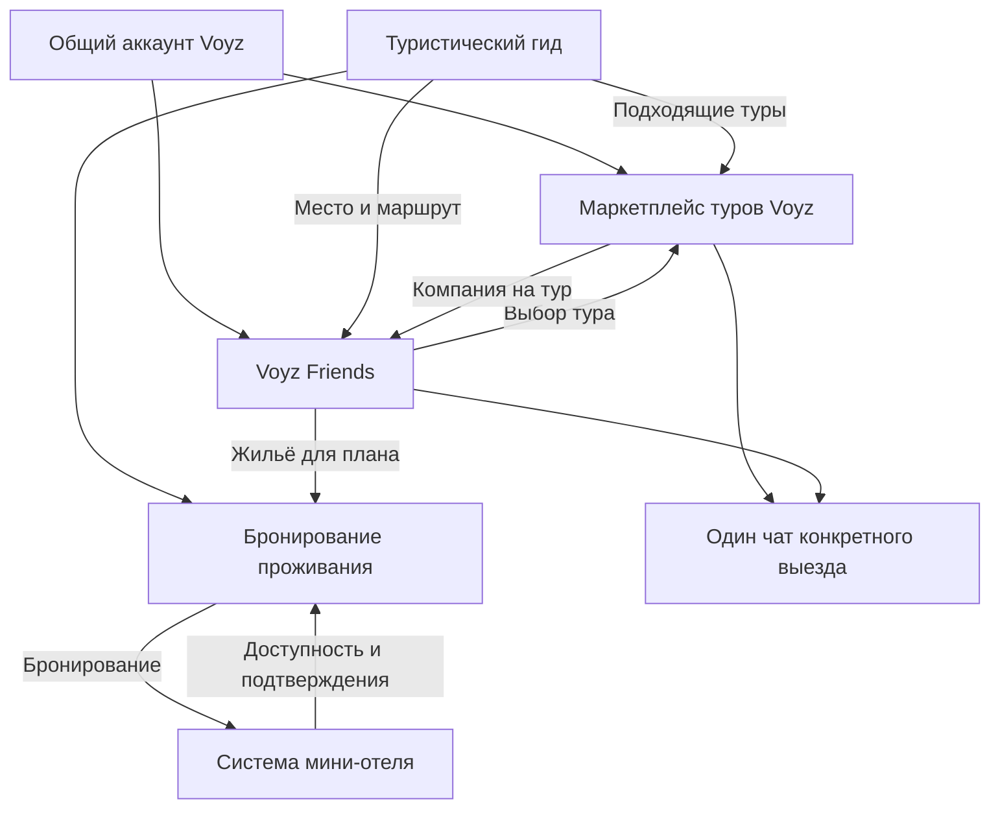

# Voyz Friends — полная спецификация для Codex

Версия 1.0 · 30 октября 2026 года · язык документа: русский.

Основной документ для передачи Codex и разработчикам. Предыдущий файл `voyz-friends-product-v1.md` — краткая продуктовая модель; при детализации использовать настоящую спецификацию, сохраняя различие согласованных решений и допущений.

**Состояние реализации:** текущий проект — React Native + Expo для iOS, Android и браузерного просмотра. Проверенные функции и ограничения перечислены в [инструкции](../README.md). Ранее был подготовлен отдельный HTML-макет; он не является кодовой базой этого приложения. Спецификация описывает целевой продукт шире текущего демо; наличие требования в документе не означает, что оно полностью реализовано в прототипе.

## 1. Назначение и порядок работы

**Последнее уточнение владельца:** использовать React для iOS/Android; текущая реализация — React Native + Expo. Создать репозиторий GitHub и опубликовать браузерный просмотр на GitHub Pages. APK/IPA и установка сейчас не требуются. Реальные связи с Voyz пока не подключать.

Этот документ — самостоятельное задание на проектирование и создание интерактивной вёрстки отдельного приложения для поиска попутчиков и друзей в экосистеме Voyz. Он содержит продуктовые решения, пользовательские сценарии, правила состояний, дизайн, будущие интеграции и критерии проверки. Для понимания задачи не требуется читать историю переписки.

**Текущая задача Codex:** создать качественный адаптивный интерфейс с локальными демонстрационными данными и воспроизводимыми сценариями. Серверные связи, реальные аккаунты, сообщения, покупки, проверку личности и платежи программисты подключат позднее.

**Не подменять задачу:** нужен интерфейс продукта, а не рекламный лендинг. Недостаточно нарисовать один экран или набор неработающих кнопок. Основные действия должны менять демонстрационное состояние, а важные состояния должны быть доступны для просмотра и тестирования.

Приоритет: последние прямые указания владельца продукта → согласованные правила этого документа → явно обозначенные проектные допущения. При наличии противоречий нельзя молча менять механику. Уточнение, которое действительно блокирует реализацию, записывается отдельно; остальные экраны можно разрабатывать независимо.

### 1.1. Обозначения

- **Согласовано:** решение принято владельцем продукта в обсуждении.
- **Проектное допущение:** предложенное здесь подробное правило для связности реализации, ещё не утверждённое отдельно. В демо его можно реализовать, сохранив возможность изменить.
- **Будущая интеграция:** требуемая связь экосистемы; её техническая готовность не проверена.
- **Открытый вопрос:** требуется решение перед соответствующей частью промышленного запуска; интерфейс может использовать явно описанное допущение.

Название **Voyz Friends — рабочее**. Утверждены название с Voyz и оформление в стиле Voyz; слово Friends окончательно не утверждено.

## 2. Контекст бизнеса

У владельца уже работает маркетплейс авторских туров **Voyz**, приложения iOS и Android. По подтверждению владельца в нём есть вход по телефону, личные профили, переписка с организатором, групповые чаты, бронирование конкретного выезда и онлайн-оплата.

Сейчас разрабатывается туристический гид: сведения о конкретных местах, как добраться, где припарковаться, когда посещать, где жить и другие практические детали.

В планах — прямое бронирование проживания и административная система для мини-отелей. Выражение «мини TravelLine» описывает замысел, а не выбранную интеграцию с TravelLine.

Voyz Friends — отдельное приложение с общим аккаунтом Voyz. Оно помогает найти людей, согласовать совместную поездку и воспользоваться другими продуктами экосистемы.

Стратегия владельца: сначала бесплатная полезность, выход на рынок, взаимный трафик продуктов, затем монетизация экосистемы. Подписки, платные сообщения, платное продвижение анкет и комиссии Friends пока не утверждены. Не вводить их самостоятельно.

## 3. Аудитория, территория и назначение

**Согласовано:**

- Начинаем с Кыргызстана; дальнейшее развитие — международное.
- Пользователи — жители Кыргызстана и приезжие туристы.
- Только пользователи 18+.
- Интерфейс: русский, кыргызский, английский. Языки общения задаются в профиле отдельно от языка интерфейса.
- Назначение: компания для путешествий и дружба. Романтический режим не предусмотрен.
- Поиск не является сервисом регулярного извоза. Совместный транспорт может быть частью путешествия.
- Пользователь может искать компанию без уже созданного маршрута.

Первая версия охватывает три сценария: небольшие поездки на 1–3 дня; попутчики для путешествия по Кыргызстану любой продолжительности; компания для авторского тура Voyz.

## 4. Границы текущей реализации

### 4.1. Сделать сейчас

Адаптивный интерфейс, компоненты и экраны; локальные сценарии входа и анкеты; поиск людей и поездок; фильтры; заявки; одобрение; резерв; подтверждение «Еду»; чаты; создание поездки; управление участием; изменения условий; демонстрацию смены автора; профиль; жалобы; отзывы; демонстрационные переходы в другие продукты; состояния загрузки, отсутствия данных, ошибок и закрытого доступа.

Локальные изменения сохраняются между перезагрузками в браузере. Нужен понятный сброс демоданных. На первой загрузке обозначить, что это демонстрация и сообщения никому не отправляются. Демонстрационную панель отделить от обычных пользовательских действий.

### 4.2. Не подключать сейчас

Реальные сервисы Voyz, SMS, проверку документов и фото, внешнюю авторизацию, реальные чаты, пуши, аналитику, платежи, гостиничные остатки, бронирования, сбор денег группы, банковские переводы, внешнюю модерацию, загрузку файлов на сервер. Не вставлять вымышленные рабочие API-адреса и ключи. Не показывать демонстрационную покупку как настоящую.

Реализация в браузере — прототип интерфейса для будущего мобильного приложения, не готовое нативное приложение для магазинов.

## 5. Карта экосистемы

Общий аккаунт с гидом и гостиничной системой — целевая возможность, не отдельно согласованная готовая связь. Совпадение аккаунта не делает все сведения доступными каждому продукту или пользователю.

### 5.1. Сквозные сценарии

1. **Из гида:** место → «Найти компанию» или «Создать поездку» с предзаполненным местом → группа → самостоятельная организация либо тур → проживание при необходимости.
2. **Из Friends:** подходящие люди → общий план → подбор авторского тура → покупка в Voyz каждым участником → чат забронировавших конкретный выезд.
3. **Из маркетплейса:** выбранный тур → поиск компании до покупки → возврат в тот же тур и выезд → бронирование.
4. **После покупки:** подтверждённый заказ → общий чат выезда в любом из двух приложений. Публичная анкета Friends не включается автоматически.
5. **Проживание:** выбор объекта на даты поездки → бронирование → заказ в системе мини-отеля. Групповая договорённость сама по себе не создаёт заказ.
6. **После поездки:** подтверждение совместного участия → отзыв → сохранение контакта через уже принятый личный чат → новый план.

## 6. Сущности: что нельзя смешивать

| Сущность | Смысл |
|---|---|
| Аккаунт | Один человек в системе идентификации Voyz |
| Анкета путешественника | Социальные сведения Friends с отдельной видимостью |
| Место | Туристический объект из будущего общего справочника |
| Самостоятельная поездка | План, который создаёт пользователь и для которого принимает участников |
| Заявка | Просьба конкретного пользователя войти в конкретную поездку |
| Резерв | Временное удержание одного места после одобрения заявки |
| Участие | Подтверждённое согласие человека ехать по актуальным условиям |
| Тур | Коммерческое предложение организатора в Voyz |
| Выезд | Конкретная дата или период коммерческого тура |
| Бронирование | Коммерческий заказ с собственными правилами оплаты и отмены |
| Чат | Переписка с отдельным типом и правилами доступа |
| Жалоба | Обращение в поддержку, независимое от отзывов |
| Отзыв | Обратная связь после подтверждённого совместного путешествия |

Принятие в компанию на тур не гарантирует место в туре. Выход из чата не отменяет заказ. Изменение самостоятельной поездки не меняет автоматически коммерческую бронь.

## 7. Роли и права

Роли относятся к конкретной поездке. Один человек может быть автором одной поездки, кандидатом в другой и подтверждённым участником третьей.

| Действие | Посетитель без входа* | Заполненная анкета | Кандидат | Резерв | Подтверждённый участник | Автор | Поддержка |
|---|---|---|---|---|---|---|---|
| Смотреть публичную поездку | Да | Да | Да | Да | Да | Да | По полномочиям |
| Смотреть анкеты | Ограниченно | Да | Да | Да | Да | Да | По полномочиям |
| Подать заявку | Нет | Да | Одна активная | Уже подана | Уже участвует | В свою — нет | Не от имени пользователя |
| Читать и писать в чате поездки | Нет | Нет | Нет | Да | Да | Да | Только при служебной необходимости |
| Видеть точную точку сбора | Нет | Нет | Нет | Да | Да | Да | По полномочиям |
| Подтвердить «Еду» | Нет | Нет | Нет | Да | Уже подтверждено | Организует | Нет |
| Одобрять заявки | Нет | Нет | Нет | Нет | Нет | Да | Не обычное действие поддержки |
| Исключать с причиной | Нет | Нет | Нет | Нет | Нет | Да | Модерационные меры отдельно |
| Изменять условия | Нет | Нет | Нет | Нет | Нет | Да | Не без отдельного основания |
| Подать жалобу | Вход для отправки* | Да | Да | Да | Да | Да | Рассматривает |

*Публичный просмотр без входа — проектное допущение. Предлагается разрешить просмотр карточек поездок, а для анкеты показывать ограниченный предварительный просмотр до входа. Уточнить перед запуском.

Участник резерва имеет доступ к чату, но не считается окончательно едущим. Автора нельзя исключить его собственной кнопкой «Исключить»: для него предусмотрен выход со сменой автора.

## 8. Вход, возраст и анкета

### 8.1. Первый запуск

Короткий вводный экран: «Найди компанию для путешествий по Кыргызстану». Два входа в продукт: «Смотреть поездки» и «Войти через Voyz». Не делать длинную обязательную презентацию.

Вход использует существующую систему Voyz. В текущем прототипе — демонстрационный вход с явной маркировкой. Не отправлять SMS и не собирать реальные документы.

После входа пользователь подтверждает или заполняет общие поля и социальную анкету. Не копировать телефон в публичную анкету. Пользователь выбирает язык интерфейса и языки общения независимо.

Для отправки сообщений и заявок нужны имя, возраст, фото с лицом, город, языки общения, короткое описание, подтверждённый телефон и проверенное фото.

Возраст рассчитывать из даты рождения, а не постоянно редактируемого числа — проектное допущение. Дату рождения публично не показывать. До 18 лет социальные функции недоступны. Вопрос о правилах возраста самой экосистемы Voyz остаётся отдельным: запрет Friends не означает удаление общего аккаунта.

### 8.2. Проверки

У телефона и фото разные состояния: не начата, выполняется, успешно, требуется повторить, отклонена, ошибка сервиса. Пользователь видит конкретную причину, если её можно раскрыть, и действие для исправления. Фото должно соответствовать человеку; способ проверки ещё не выбран.

Показывать «Телефон подтверждён» и «Фото проверено», а не «Полностью безопасен». Проверка документов — позднее, не отображать её как выполненную.

Повторное использование проверки Voyz допускается только при совместимых методах и поддержке действующего сервиса. Демо содержит отдельный сценарий неподтверждённой анкеты.

### 8.3. Поля анкеты

Обязательные поля перечислены выше. Дополнительные: интересы, предпочтительный темп, комфорт, отношение к ранним подъёмам, курению и алкоголю, опыт, транспорт и готовность водить, направления и доступные даты, ориентир бюджета. Эти сведения не объявлять обязательными без решения владельца.

Предпочтения используются для объяснимых рекомендаций. Не показывать придуманный процент совместимости. Писать конкретно: «Совпадают язык и даты», «Бюджет пока не указан».

Имя, возраст и телефон — общая основа с Voyz. Изменение общего поля в Friends должно предупреждать о синхронизации. Фото, описание, интересы и видимость социальной анкеты отдельные, пока не согласовано иное.

## 9. Видимость и приватность

Анкета появляется в поиске «Люди» только после явного включения «Ищу компанию». Для этого конкретная поездка не нужна. Выключение убирает из выдачи, но не удаляет аккаунт, поездки и принятые чаты — проектное допущение.

Публичны: имя, возраст, город, языки, описание, добровольно заполненные интересы и отметки проверок. Принятые участники поездки представлены публичными анкетами; список ожидающих кандидатов доступен автору, а не всем посетителям.

Скрыты: телефон, фамилия из Voyz, дата рождения, точная геолокация, бронирования, сведения оплаты. Точная точка сбора доступна после одобрения заявки, включая резерв. Публично — примерный район старта.

Выключенная из поиска анкета может оставаться доступна через участие в публичной поездке — проектное допущение; это объяснить рядом с переключателем. Блокировка между людьми должна переопределять обычный доступ к профилю; поведение в общей группе описано ниже.

Закрытие доступа к чату не равно удалению сообщений у остальных. Нельзя технически отозвать уже сделанные скриншоты или прочитанную информацию. Точный срок хранения и служебный доступ определяются отдельно.

## 10. Поиск людей и знакомство

Основной режим — лента карточек, дополнительный — свайпы. Одинаковый состав людей и фильтры в обоих режимах. Свайпы не должны быть единственным способом действия; есть доступные кнопки.

Карточка: фото, имя и возраст, город, языки, 1–3 интереса, краткое описание или план, отметки проверок. Не придумывать активность «сейчас онлайн» и расстояние, если таких данных нет.

Полная анкета: дополнительные фото, описание, предпочтения, будущие планы, публичные поездки и отзывы, если доступны. Основное действие — «Предложить познакомиться»; дополнительные — пожаловаться и заблокировать.

Проектное допущение для свайпов: влево — пропустить, вправо — открыть форму запроса. Ни один жест не отправляет сообщение без подтверждения. Пропуск не равен отказу в уже полученном запросе.

### 10.1. Фильтры

Направление/место, даты, язык общения, возраст 18+, формат отдыха, бюджет с вариантом «обсудим», пол попутчиков. Город проживания и место встречи разделены, приезжие не исключаются по умолчанию.

Даты могут пересекаться частично. В карточке указывать пересечение и несовпадение явно. При отсутствии даты человек остаётся доступен в широком поиске, но при строгом фильтре дат — только с включённым «Показывать без дат» (допущение). Аналогично бюджету: не считать неизвестный бюджет совпавшим.

Фильтры применяются по явной кнопке, доступны сброс и число активных условий. Сохраняются при возврате из анкеты. Пустая выдача предлагает изменить условия. Не ослаблять фильтры молча.

### 10.2. Личные запросы

Согласовано: максимум пять новых запросов незнакомым людям в сутки; до принятия — одно сообщение; получатель принимает либо отклоняет; после отказа повторный запрос недоступен. После принятия общение свободное.

Проектные допущения: сутки считаются по Asia/Bishkek с показом времени следующего сброса; неуспешная отправка не тратит лимит; отозванный успешно отправленный запрос лимит не возвращает; взаимные встречные запросы приводят к одному принятому чату после явного согласия; отказ не раскрывает причину отправителю. Срок неотвеченного запроса пока не утверждён — автоматически не считать его отказом.

Состояния: можно отправить, отправлено/ожидает, входящий, принят, отклонён, отозван, заблокирован, недоступен, лимит исчерпан. Повторное нажатие не создаёт дубликат и не расходует второй запрос.

Лимит личных запросов не применять к сообщениям в уже принятых чатах. Отдельный предел заявок в поездки пока не утверждён; для промышленного сервиса нужен самостоятельный контроль злоупотреблений.

## 11. Каталог поездок

Отдельные видимые типы: «Самостоятельная» и «Авторский тур Voyz». Можно показать общую ленту с фильтром типа. Коммерческое предложение всегда помечено организатором.

Карточка самостоятельной поездки: иллюстрация или фото, название места/маршрута, даты и гибкость, длительность, примерный старт, свободные места, состав компании, бюджет или «Обсудим вместе», автор и несколько аватаров участников.

У тура: организатор, конкретный выезд при наличии, цена и статус предложения из Voyz. Не выдавать число мест социальной компании за свободные коммерческие места.

Фильтры поездок: направление, даты, длительность, свободные места, язык, формат отдыха, бюджет, состав компании. Условия возраста и подготовки — пожелания. Фото и имена демонстрационные; фотография не должна выдаваться за достоверное изображение конкретного места, если соответствие не проверено.

Состояния каталога: загрузка, данные, нет совпадений, пока нет поездок, ошибка с повтором, офлайн с доступным кэшем, предложение больше недоступно. Возврат сохраняет фильтры и положение прокрутки.

## 12. Создание самостоятельной поездки

Создавать может путешественник с заполненной проверенной анкетой. Коммерческие туры публикуются через Voyz. Не добавлять кнопку публикации коммерческого тура прямо из обычного профиля Friends.

Обязательные данные:

- Место или маршрут по Кыргызстану.
- Точные либо примерные даты.
- Длительность.
- Точка встречи; точный адрес закрыт, примерный район публичен.
- Количество свободных мест.
- Описание и примерный бюджет на человека; для бюджета допускается «Обсудим вместе».

Автор выбирает женскую, мужскую или смешанную компанию. Возраст и подготовка — пожелания. Может добавить до трёх вопросов к заявке. Дополнительные поля: фото, остановки маршрута, транспорт, формат проживания, включённые расходы, опыт, что взять с собой.

### 12.1. Предлагаемый мастер

1. **Куда и когда:** название, место, точные/гибкие даты, длительность.
2. **Компания и условия:** места, состав, пожелания, бюджет/обсудим, встреча и транспорт.
3. **Описание и публикация:** описание, фото, до трёх вопросов, предварительный просмотр.

Черновик сохраняется при переходах назад. Публикация валидирует весь набор, показывает ошибки рядом с полями и сводку с фокусом на первой ошибке. Не терять введённое после ошибки.

Проектные допущения: количество мест — приглашённые люди, автор учитывается отдельно в общем составе; диапазон 1–20 свободных мест для демо, производственный максимум уточнить; диапазон бюджета неотрицательный, нижняя граница не выше верхней; конец не раньше начала; место относится к Кыргызстану на стартовом рынке; прошедшие даты нельзя публиковать. При гибком периоде длительность задаётся отдельно и не может превышать весь период.

Связь с местом гида предзаполняет объект, но не выдумывает доступность дороги, парковки или сезона. Географические сведения в демо иллюстративны.

## 13. Экран поездки

Сверху — фото и основные сведения, далее автор, маршрут, условия, бюджет, состав, публичные анкеты принятых участников, пожелания, вопросы и основное действие в зависимости от роли.

Точная точка сбора до принятия скрыта с объяснением. Кандидаты не видят групповой чат. Автор видит заявки в отдельном разделе. Неподтверждённый резерв обозначен явно, его нельзя визуально смешивать с окончательно едущим участником.

Основные действия:

- Посетитель: войти для заявки.
- Подходящая анкета: подать заявку.
- Неполная анкета: завершить профиль с возвратом в поездку.
- Заявка ожидает: посмотреть/отозвать заявку.
- Резерв: подтвердить «Еду», видеть срок, открыть чат.
- Подтверждённый: открыть чат, условия, выйти.
- Автор: заявки, редактирование, закрытие набора, управление участниками.
- Набор закрыт или мест нет: объяснение, доступные альтернативы; обычную заявку не принимать.
- Исключённый: причина и обращение в поддержку, без истории чата.

## 14. Заявки, одобрение и резерв

### 14.1. Подача

Каждый взрослый подаёт заявку со своего профиля. Нет заявок за спутников, групповых заявок, детских мест и анонимных участников в первой версии.

Заявка содержит сообщение, согласие с актуальной версией условий, ответы на вопросы автора (до трёх). При изменении условий во время заполнения показать изменения и запросить новое согласие перед отправкой. Одна активная заявка на человека в поездке.

Автор принимает или отклоняет заявку. Он может познакомиться с кандидатом через личный запрос по общим правилам; это не открывает чат поездки. Решение автора не требует оплаты.

### 14.2. Одобрение

При одобрении создаётся резерв на 24 часа, но не позднее старта. Сразу открываются чат и точная точка сбора. Участник ещё не считается подтвердившим «Еду».

Для гибких дат техническая граница старта не согласована. Допущение: срок резерва ограничен ближайшим допустимым началом периода; перед фактическим выездом группа должна подтвердить точную дату. Демо должно явно различать гибкую идею и подтверждённую дату.

Если мест уже нет, одобрение не выполняется и объясняет причину. Синхронное одобрение нескольких заявок не должно переполнить поездку. Повторное одобрение той же заявки не создаёт второй резерв.

### 14.3. Подтверждение

Нажатие «Еду» подтверждает актуальные условия и переводит резерв в занятое место. Время резерва определяется системой, а не часами устройства. В демо используются локальные часы и отдельное действие для проверки истечения срока.

При истечении срока место освобождается; вся переписка группы становится недоступна. Роли гостя нет. Возвращение — новая заявка и повторное одобрение автора, затем новое подтверждение «Еду».

### 14.4. Состояния заявки

| Состояние | Место | Групповой чат | Следующее действие |
|---|---|---|---|
| На рассмотрении | Не занято | Нет | Решение автора или отзыв |
| Отклонена | Не занято | Нет | Отображение результата |
| Одобрена, резерв | Временно занято | Да | «Еду», отказ или истечение |
| Участие подтверждено | Занято | Да | Поездка, изменения или выход |
| Отозвана до одобрения | Не занято | Нет | Новая заявка по допущению |
| Резерв истёк | Освобождено | Нет, включая историю | Новая заявка |
| Добровольно вышел | Освобождено | Нет, включая историю | Новая заявка |
| Исключён | Освобождено | Нет, включая историю | Обжалование |
| Отказ от изменений/нет ответа | Освобождено | Нет, включая историю | Новая заявка на актуальные условия |

Повторные заявки после отклонения не согласованы. Допущение: после явного отказа автора повтор недоступен, пока автор не разрешит его; правило запрета повторного личного запроса не переносить автоматически на все заявки. После исключения повтор запрещён до решения автора/поддержки — допущение.

### 14.5. Учёт мест

Вместимость приглашённых ≥ подтверждённые участники + активные резервы. Свободно = вместимость − подтверждённые − резервы. Автор показывается в составе отдельно. Ожидающие заявки не занимают места. Не уменьшать вместимость ниже уже занятых и зарезервированных без отдельного решения и уведомления.

## 15. Жизненный цикл самостоятельной поездки

Проектные состояния: черновик → опубликована/набор открыт → набор закрыт → идёт поездка → завершена. Отдельный терминальный статус — отменена.

Дополнительные процессы не стирают основной статус: ожидание повторных подтверждений; выбор нового автора; модерационное ограничение. Для программистов желательно хранить их отдельно, чтобы не получить десятки неоднозначных комбинированных статусов.

Автор закрывает набор без отмены поездки и без закрытия чата уже принятым. Возобновление возможно до старта при наличии мест. Автоматический переход по времени — допущение; для гибких дат потребуется явное подтверждение фактических дат.

После начала новые заявки по допущению закрыты. После завершения открываются подтверждение совместного участия и отзывы. В архиве сохраняются карточка и доступ действующих участников к чату; точные сроки архивации обсуждаются отдельно.

Отмена самостоятельной поездки не отменяет покупок Voyz и проживания. Допущение: при отмене чат становится доступным действующим участникам только для чтения на период урегулирования, новые сообщения закрыты; этот порядок требует утверждения. Не применять к отмене неоговорённое удаление переписки.

## 16. Изменение условий

Согласовано: существенное изменение дат, маршрута или бюджета требует повторного подтверждения. Срок ответа 24 часа, но не позднее нового старта. До ответа место сохраняется. При отказе или отсутствии ответа участие прекращается, место освобождается, вся переписка закрывается.

Проектное определение существенности: любое изменение дат или временного окна; основного направления/обязательной остановки; диапазона бюджета или смена «обсудим» на сумму; смена валюты. Для точной точки встречи, транспорта, состава компании и иных значимых условий предложить отдельное предупреждение; необходимость повторного подтверждения не утверждена.

Описание опечатки и новая фотография не должны запускать подтверждения. Для каждого набора условий хранится версия. На экране видно «Было → Стало», автор изменения и срок ответа. Согласие привязано к версии, а не к флагу без контекста.

Допущения: автор сначала видит предварительный просмотр изменений; перенос в прошлое запрещён; при нескольких изменениях согласия нужны на последнюю версию, но массовые изменения не должны бесконечно продлевать чужие резервы; исходный резерв и повторное подтверждение — отдельные сроки. Подробное правило совместных таймеров требуется утвердить перед серверной реализацией. В демо показывать один сценарий изменения подтверждённой поездки.

## 17. Выход и исключение

Добровольный выход требует подтверждения последствий: место освободится, вся переписка станет недоступна; коммерческие бронирования не отменяются. После подтверждения закрываются чат и точная точка сбора. Повтор — через новую заявку.

Автор может исключить участника с указанием причины. Причина хранится отдельно от переписки и доступна исключённому вместе с кнопкой обращения в поддержку. Место освобождается, вся переписка закрывается. Поддержка Voyz рассматривает обжалование. Жалобу на автора не рассматривает сам автор.

Исключение другого участника не должно удалять его сообщения из истории остальных. Решение по отзыву, обращениям и доказательствам не зависит от сохранения у исключённого доступа к чату.

## 18. Смена автора

Согласовано: после выхода автора группа выбирает нового; желающие выдвигаются, голосование 48 часов, кандидат с большинством голосов принимает роль; при равенстве второй тур; новые заявки приостановлены; если никто не согласился, поездка отменяется.

Для полного демо использовать следующие **проектные допущения**, не выдавая их за уже согласованные:

- Голосуют подтверждённые участники, оставшиеся в группе на момент открытия голосования. Резерв не даёт права голоса.
- Один голос на человека; кандидат может голосовать. До завершения голос можно изменить.
- Победитель — кандидат с наибольшим числом голосов; определение «большинства» и кворум требуют утверждения.
- Кандидат заранее соглашается принять роль при победе. После результата получает явное подтверждение назначения.
- Второй тур — 24 часа между лидерами. Повторная ничья, отсутствие голосов или отказ победителя направляются поддержке; без согласившегося автора поездка не продолжается автоматически.
- Если старт раньше окончания выборов, показывать конфликт сроков и обращение в поддержку; не переносить старт молча.
- Неотвеченные заявки сохраняются без обработки до выбора. Уже активные резервы живут по собственным срокам и не продлеваются автоматически.

Перед выходом автор видит последствия и может отменить действие. После успешной смены новый автор получает права управления; прежний их теряет. История авторства сохраняется.

## 19. Чаты и сообщения

Три типа: личный принятый чат; групповой чат самостоятельной поездки; общий чат забронировавших коммерческий выезд.

Для каждого сообщения: автор, текст, время, статус локальной/серверной отправки. В демо не создавать ложный ответ от реального человека. Предзаполненные сообщения помечены как демоданные; новые сохраняются локально.

В первой вёрстке достаточно текста. Вложения, голосовые, звонки, редактирование и удаление сообщений — будущие возможности, пока не согласованные. Не делать их неработающими активными кнопками.

Чат самостоятельной поездки открыт после одобрения, включая резерв. Над перепиской — актуальный статус поездки, условия и резерв/подтверждение. Неподтверждённый участник видит постоянную кнопку «Еду» и срок.

После выхода, исключения, истечения резерва, отказа от новых условий или пропуска ответа нет доступа ко всей переписке, включая ранее загруженную историю. В промышленной реализации недостаточно спрятать чат в меню: сервер проверяет права на историю, новые сообщения, вложения и подписку на события. Локальный прототип не обеспечивает такую защиту и не должен утверждать обратное.

При повторном вступлении состав доступной старой истории не согласован. Допущение: показывать историю с нового одобрения; вопрос пометить в передаче разработчикам.

Системные сообщения: участник принят/подтвердил/вышел; условия изменились; набор закрыт; выбор автора; поездка отменена/завершена. Не раскрывать в общей группе подробности чужой жалобы или оплаты.

## 20. Авторские туры и общий чат Voyz

Коммерческие туры поступают из Voyz с организатором. Поиск компании до покупки и чат забронировавших — разные пространства.

До покупки пользователь может создать социальный план, связанный с туром/выездом. Это не бронь и не блокировка коммерческого места. После выбора тура открывается Voyz с тем же предложением и датой, если она ещё доступна. Изменившиеся цены и наличие показываются перед покупкой в Voyz.

Согласовано: один общий чат конкретного выезда доступен в Voyz и Friends, сообщения одни и те же. Общий аккаунт позволяет идентифицировать человека. Дублировать независимые чаты вместо одного нельзя.

Источником факта бронирования и правил оплаты остаётся Voyz. Кто именно считается допущенным — предоплата, полная оплата, ручное подтверждение — открытый вопрос; нужно использовать реальную политику Voyz, не придумывать её.

При отмене брони, переносе выезда, возврате или недоступности тура Friends обновляет соответствующий статус. Правила закрытия истории чата коммерческого выезда согласуются с Voyz отдельно. Не переносить на коммерческий чат правила самостоятельных поездок без проверки.

Уведомления одного сообщения в двух приложениях должны согласовываться, чтобы избежать дублей. Технический способ требует проверки. В прототипе переход отображает информационный экран «Связь с Voyz будет подключена» и не создаёт настоящую покупку.

## 21. Туристический гид

Будущие действия с места: посмотреть информацию, сохранить интерес, найти компанию, создать поездку, посмотреть туры, найти проживание.

Общий объект места должен иметь устойчивый идентификатор, название на нужных языках, примерные координаты и ссылку на источник. Не копировать несинхронные карточки одного места в каждом продукте.

План может включать несколько мест и порядок остановок. «Хочу сюда» не равно «Еду» и не делает человека подтверждённым попутчиком на даты. Если пользователь лишь сохранил интерес, не показывать его как доступного участника.

В текущем прототипе — демонстрационная карточка места и объяснение будущего перехода, без заявлений о проверенных дорогах, погоде и открытости маршрута.

## 22. Проживание и система мини-отеля

Целевая цепочка: место/план → даты, количество гостей и требования → подходящие объекты → актуальная доступность → подтверждённый заказ → обработка объектом.

У мини-отеля планируется свой административный кабинет. Предполагаемые направления: номерной фонд, занятость, заявки и бронирования, гости, статусы заезда/выезда. Точный функционал, тарифы, платежи и архитектура гостиничного продукта ещё не утверждены.

Перед промышленной реализацией определить источник истины по остаткам, типам номеров, тарифам и отменам; сроки удержания номера; доступность оплаты; подтверждение от объекта; предотвращение двойной продажи. Групповой резерв Friends не является гостиничным резервом.

Покупатель жилья добровольно делится с группой только выбранными сведениями. Телефон, номер комнаты, документ гостя и детали платежа не публикуются. Выход участника из компании не изменяет чужую гостиничную бронь.

## 23. Отзывы и подтверждение поездки

Согласовано: отзыв после завершения и взаимного подтверждения совместного участия. Жалоба доступна в любое время, не требует согласия второй стороны.

Предлагаемая механика: после завершения выбрать, с кем действительно путешествовал; второй участник подтверждает факт; отзыв становится доступен для этой пары. Одностороннее подтверждение не даёт публичный отзыв. Автор не подтверждает за всех.

Проектные допущения: оценка 1–5 и текст; публикация после ответа второй стороны или по окончании 14 дней, но только если факт участия уже подтверждён; жалобы и апелляции рассматривает поддержка; не отображать средний рейтинг при отсутствии отзывов. Метод подтверждения автора поездки и отзывов организаторов тура требует отдельного согласования.

Нельзя делать отзыв единственным способом сообщить о нарушении: другая сторона может отказаться подтверждать участие.

## 24. Жалобы, блокировки и поддержка

Поддержка Voyz существует и принимает обращения Friends. Жалобы доступны из анкеты, поездки, чата и сообщения. После потери чата обратиться можно из экрана статуса участия и профиля поддержки.

Поля: категория, описание, связанный объект/сообщение при наличии, способ ответа в приложении. Не заставлять потерявшего доступ пользователя прикладывать недоступную ему переписку; идентификатор поездки и решение доступны поддержке в рамках полномочий.

Предлагаемые категории: спам, мошенничество, нежелательные знакомства/домогательства, оскорбления/угрозы, ложная информация, нарушение условий поездки, другое. Не обещать круглосуточную или экстренную помощь без фактической возможности.

Личная блокировка прекращает новые запросы и личные сообщения. Общая группа — отдельный случай: блокировка не должна молча удалять обоих из поездки или давать автору возможность управлять чужим аккаунтом. Допущение: сообщения заблокированного можно скрыть в интерфейсе с уведомлением о совместной группе и действием обратиться в поддержку. Детали согласовать.

Прототип: форма обращения, локальный номер, экран статуса с маркировкой «Демо». Не утверждать, что команда получила реальное обращение.

Минимальный будущий кабинет поддержки: очередь, категории, связанный объект, история решений, комментарии, ограничение нарушителя, восстановление доступа по решению, журнал действий. Уровни полномочий и сроки реакции ещё не утверждены.

## 25. Навигация и реестр экранов

Предлагаемая нижняя навигация: Люди, Поездки, Мои планы, Сообщения, Профиль. На телефоне максимум пять пунктов, на широком экране — боковое меню. Структура была предложена в обсуждении, не утверждена отдельным ответом; для вёрстки используется как допущение.

| Код | Экран | Основное содержание и действие |
|---|---|---|
| A01 | Введение/вход | Описание, вход Voyz, просмотр поездок |
| A02 | Заполнение анкеты | Обязательные поля и возврат в исходное действие |
| A03 | Проверки | Телефон и фото с раздельными статусами |
| P01 | Люди | Лента, фильтры, переключатель свайпов |
| P02 | Анкета человека | Профиль, предпочтения, поездки, запрос |
| P03 | Новый личный запрос | Одно сообщение, остаток лимита |
| P04 | Входящий запрос | Анкета, сообщение, принять/отклонить |
| T01 | Поездки | Лента самостоятельных и коммерческих предложений |
| T02 | Фильтры поездок | Применить, сбросить, пустые состояния |
| T03 | Самостоятельная поездка | Публичные условия и действие по роли |
| T04 | Заявка | Сообщение, вопросы, согласие с версией |
| T05 | Создание/черновик | Мастер и предпросмотр |
| T06 | Заявки автору | Список, анкета, ответы, решение |
| T07 | Резерв | Срок, «Еду», отказ, чат |
| T08 | Участники | Подтверждённые и резервы, управление автором |
| T09 | Изменение условий | Сравнение, подтверждение, срок |
| T10 | Выход/исключение | Последствия, причина, обращение |
| T11 | Смена автора | Выдвижение, голосование, результат |
| T12 | Завершение/отзыв | Подтверждение факта участия, отзыв |
| M01 | Мои планы | Участвую, мои заявки, организую, архив |
| C01 | Сообщения | Запросы, личные и групповые чаты |
| C02 | Личный чат | Переписка, профиль, жалоба/блокировка |
| C03 | Чат поездки | Условия, статусы, сообщения, «Еду» |
| C04 | Чат выезда Voyz | Связь с конкретным выездом и бронью |
| U01 | Профиль | Анкета, видимость, проверки |
| U02 | Настройки | Язык, уведомления, блокировки, поддержка |
| U03 | Уведомления | События и переход к актуальному объекту |
| S01 | Обращение | Причина, текст, подтверждение/статус |
| E01 | Тур Voyz | Демонстрация перехода к предложению |
| E02 | Место гида | Карточка и будущие переходы |
| E03 | Проживание | Демонстрация связи с планом |
| D01 | Демо-сценарии | Смена состояний, очистка локальных данных |

Не обязательно делать каждый пункт отдельной страницей: подходят модальные окна и нижние панели при сохранении понятной навигации и кнопки возврата.

## 26. Визуальная основа: запись Voyz Guide

Референс владельца: предоставленная запись Voyz Guide, длительность около 31 секунды. Опорные кадры приложены ниже.

Опорные кадры приложены: [выбор направления](voyz-reference/guide-03.png), [карточки и навигация](voyz-reference/guide-09.png), [обзор записи](voyz-reference/contact.jpg). При передаче сохранять папку `voyz-reference` рядом с документом. Это кадры предоставленного пользователем дизайна, а не готовые исходники компонентов.

Наблюдаемые элементы: чёрная верхняя зона, белая поверхность с крупным верхним скруглением, лаймовый акцент, фотокарточки с закруглениями и затемнением под текст, сетка с карточками разной высоты, круглые подборки мест, строка поиска с нижней линией, плавающая полупрозрачная нижняя навигация.

Сохранить этот характер при адаптации к людям и социальным сценариям. Не заменять его случайным синим туристическим шаблоном. Точные исходные цвета, шрифт и логотип не получены; значения ниже — приближение по записи, а не официальный брендбук.

### 26.1. Предлагаемые токены

- Основной фон верхней зоны: `#000000`.
- Поверхность: `#FFFFFF`.
- Лаймовый акцент: примерно `#D5FF00`, чёрный текст на нём.
- Вторичная поверхность: `#F3F4EF`.
- Вторичный текст: `#62665E`.
- Разделители: `#E2E5DC`; для значимых границ контролов нужен достаточный контраст.
- Скругления: крупная поверхность 32–38 px; фото 24–28 px; поля 14–16 px; компактные метки и навигация — капсула.
- Сетка отступов 4/8 px. Типовые поля 16–24 px на телефоне, шире на большом экране.
- Шрифт: нейтральный гротеск с кириллицей и кыргызскими символами; до получения фирменного использовать локальный системный стек. Не утверждать, что подобран оригинальный шрифт.

Основной акцент — фотография и содержание. Не добавлять декоративные градиентные облака, избыточные тени, эмодзи вместо навигационных иконок. Иконки — единый набор линий SVG.

### 26.2. Адаптивность и доступность

Телефон — приоритет; ширины 320/375/390/430 px, планшет 768 px, настольный 1440 px. Вертикальная и горизонтальная ориентация. Длинные имена, кыргызские подписи, большой системный текст и увеличенный масштаб не ломают основные действия.

Кнопки от 44×44 CSS px для веб-прототипа, предпочтительно 48 px. Видимые подписи и фокус, работа с клавиатуры, Escape для диалогов, возврат фокуса после закрытия. Нельзя опираться только на цвет, жест или наведение. Текстовый контраст проверять, а не предполагать. Учитывать нижние безопасные области и экранную клавиатуру.

Анимации короткие и только по смыслу; учитывать reduced motion. Не делать автоматические карусели. Тёмная верхняя зона — часть выбранной светлой темы, отдельная полноценная тёмная тема пока не согласована.

Фотографии в локальном комплекте. Для стоковых портретов указать вымышленность анкет. Не использовать личные фотографии реальных пользователей без основания.

## 27. Языки, даты и валюты

Целевой продукт трёхъязычный. Все подписи хранить в словарях, не размазывать строки по компонентам. Пользовательский текст не переводить скрытно; будущий перевод должен позволять увидеть оригинал. Профессиональная проверка кыргызского и английского обязательна перед выпуском.

Для первой демонстрации русский может быть полностью проработан раньше других языков, но тогда это явно указать и не выдавать неработающий переключатель за полноценную локализацию.

В поездках указывать местное время места старта и часовой пояс. Технически хранить моменты в UTC, локальные даты и гибкие периоды отдельно. Для Кыргызстана базовое отображение Asia/Bishkek. Изменение часового пояса телефона не продлевает резерв.

Основная валюта примеров — KGS/сом. Бюджет — ориентир, не платёж. Валюта обязательна при сумме. Не конвертировать автоматически без источника курса и даты. Для коммерческого предложения валюта и цена приходят из Voyz.

## 28. Уведомления

События: входящий личный запрос; его принятие; новая заявка автору; одобрение/отказ; создание резерва; напоминание; подтверждение участия; истечение; изменение условий; смена автора; исключение; отмена/завершение; новое сообщение; ответ поддержки; статус бронирования Voyz.

Проектное расписание: напоминание за 2 часа до окончания резерва, а при коротком резерве — одно напоминание ближе к сроку. Не отправлять уже неактуальные напоминания. Точное расписание утвердить. Уведомление ведёт в актуальное состояние объекта, а не в старый сохранённый экран.

Пуши с перепиской не должны раскрывать закрытую точку сбора и чувствительные данные на экране блокировки. Настройки сообщений и поездок отдельные. В демо уведомления только локальные, не системные пуши. Один чат Voyz не должен порождать два одинаковых уведомления без учёта предпочтений.

## 29. Предлагаемая структура данных для разработчиков

Это логическая модель, не заявление о реальной базе Voyz. Формат существующих API выяснить отдельно.

| Объект | Основные поля |
|---|---|
| AccountRef | voyzUserId, имя, дата рождения/возраст по договорённости, телефон, статусы проверок |
| TravelerProfile | userId, фото, город, языки, описание, интересы, предпочтения, visible, blockedIds |
| PlaceRef | placeId, локализованные названия, регион, координаты общего места, deepLink |
| Trip | id, authorId, type, title, places, dates/dateWindow, duration, timezone, publicStartArea, privateMeetingPoint, capacity, composition, wishes, budget, description, questions, status, termsVersion |
| Application | id, tripId, userId, message, answers, acceptedTermsVersion, status, createdAt, decisionAt, reserveExpiresAt, confirmedAt, reason |
| Membership | tripId, userId, role, status, joinedAt, leftAt, historyAccessStart, termsVersion, reconfirmDeadline |
| TermsChange | tripId, version, previousVersion, diff, changedAt, deadline |
| Election | tripId, candidates, eligibleVoters, votes, round, deadline, state, result |
| Conversation | id, type, tripId/departureId, memberIds, accessPolicy, source |
| Message | id, conversationId, senderId, text, sentAt, deliveryState, systemType |
| BookingRef | voyzBookingId, departureId, ownerId, eligibilityStatus; без лишних платёжных данных |
| Complaint | id, reporterId, targetType, targetId, category, description, state, supportHistory |
| Review | id, authorId, subjectUserId, tripId, participationConfirmed, score, text, publicationState |
| Notification | id, recipientId, type, objectRef, createdAt, readAt, relevance |

Идентификаторы устойчивые. Переходы по названию вместо ID недопустимы. Цена тура и остатки проживания не копируются как вечная истина в локальный план.

## 30. Будущие границы интеграции

Определить адаптеры: аккаунт/профиль Voyz; каталог туров и выезды; бронирования и допуск в чат; единая переписка; места гида; проживание/доступность; поддержка; уведомления.

В текущей реализации каждый адаптер имеет локальную заглушку. Компоненты не должны сами вызывать произвольные внешние URL. При подключении сервисов локальная заглушка заменяется реализацией без переписывания экранов.

Предлагаемые команды: запросить знакомство, принять/отклонить запрос; создать/изменить поездку; отправить/отозвать заявку; одобрить/отклонить; подтвердить участие; выйти/исключить; подтвердить условия; выдвинуться/голосовать; отправить сообщение; отправить жалобу; подтвердить участие после поездки; оставить отзыв.

Требования промышленной реализации: серверная авторизация каждого действия; проверка актуальной версии; атомарный учёт мест; защита от повторного выполнения команд; корректное восстановление после сетевых ошибок; проверка бронирования у источника; журнал административных действий. Резервирование и таймеры нельзя доверять только браузеру.

События интеграции должны обрабатываться повторно безопасно, с учётом порядка версий. Отмена брони не должна потеряться из-за старого события «подтверждена». Момент отзыва доступа к чату обязан учитывать актуальное состояние, а не только последний открытый экран.

## 31. Демо-архитектура и сохранение

Вёрстку допускается делать buildless HTML/CSS/JS либо на существующем стеке проекта. Не менять стек действующего Voyz, не имея его исходников. Сейчас исходники Voyz не предоставлены.

Рекомендуемое разделение: компоненты/экраны; дизайн-токены; словари; демонстрационные данные; состояние и переходы; адаптеры будущих связей. Состояние версионировано, перезагрузка его сохраняет. Сброс очищает только данные этого прототипа.

Демо-сущности: текущий пользователь, не менее четырёх анкет, поездки с разными условиями, собственная поездка автора, коммерческий выезд, заявки в разных состояниях, личный запрос и групповые сообщения.

Панель сценариев позволяет проверить: одобрение заявки, подтверждение, истечение, изменение условий, выход, исключение, смену автора, завершение и отзыв. Это локальный переключатель для проверки, а не возможность пользователя самостоятельно одобрять себя в реальном продукте.

Не хранить реальные секреты, документы и номера карт. Ошибка хранилища показывает понятное сообщение. Пользовательский ввод вставляется безопасно, без выполнения HTML/скриптов. Данные другого пользователя нельзя показывать через искусственную смену ID в обычном интерфейсе.

## 32. Пустые, ошибочные и конкурентные состояния

Обязательно предусмотреть:

1. Нет совпадений: сброс/изменение фильтров, создание своей поездки.
2. Неполная анкета: перечень недостающего, возврат после заполнения.
3. Проверка фото не пройдена: исправление, повтор, поддержка.
4. Пятый запрос отправлен: время следующей возможности; шестой не отправляется.
5. Получатель отказал/заблокировал: повтор не создаётся.
6. Заявка уже есть: открывается существующий статус.
7. Последнее место занято при одобрении: отказ операции без переполнения.
8. Резерв истёк в открытом чате: немедленное закрытие доступа, отдельное уведомление и новая заявка.
9. Условия изменились во время подачи/подтверждения: показать актуальную версию, не принимать старое согласие.
10. Новая дата уже прошла: запрет сохранения.
11. Автор вышел: приостановка заявок, выбор нового, явный статус.
12. Отказ/исключение: причина, обращение в поддержку без доступа к чату.
13. Отменённый тур/выезд: актуальный статус из Voyz, без ложного резервирования.
14. Сеть пропала после нажатия: не дублировать действие; статус выясняется повторной проверкой.
15. Двойной клик/повтор события: одно действие, один резерв, одно сообщение.
16. Переход по старой ссылке: понятный экран недоступности или актуальное состояние.
17. Закрытие формы: предупреждение о несохранённом либо сохранённый черновик.
18. Длинный текст, пустые пробелы, недопустимая сумма: валидация и сохранение остальных полей.

В демо сетевые состояния можно показать через панель сценариев; не требуется выдумывать реальный сервер.

## 33. Аналитика и экономика

Целевая цепочка: просмотр места/тура → выраженное намерение → заявка/знакомство → подтверждённая компания → бронирование → состоявшаяся поездка → повторное использование.

Предлагаемые события: profile_completed, visibility_enabled, search_applied, profile_opened, connection_requested/accepted, trip_created, application_sent/approved, reservation_expired, participation_confirmed, terms_reconfirmed, trip_left, voyz_tour_opened, booking_eligible, accommodation_opened, trip_completed, review_created. Имена примеры, не существующий контракт Voyz.

Показатели: доля успешных знакомств, время до полезного ответа, доля подтверждённых поездок, переходы в покупки, повторное использование, обращения/нарушения и стоимость поддержки. Не приписывать Friends все покупки пользователей: нужен отдельный анализ дополнительного эффекта.

В текущем прототипе внешнюю аналитику не отправлять. Возможные будущие доходы — туры, проживание, гостиничная система, услуги поставщиков. Тарифы и платные ограничения не утверждены.

## 34. Критерии приёмки интерактивной вёрстки

- Есть законченный основной путь и минимум пять основных разделов по предложенной навигации.
- Стиль узнаваемо следует записи Voyz Guide; референс и приблизительные токены приложены.
- Телефон 375 px и большой экран работают без горизонтального переполнения и перекрытия кнопок навигацией.
- Поиск и фильтры реально меняют демонстрационную выдачу.
- Лента людей и дополнительный режим свайпов доступны кнопками.
- Личный запрос отправляется один раз; шестой за сутки запрещён; отказ блокирует повтор.
- Заявка собирает сообщение, ответы до трёх вопросов и согласие с условиями.
- Автор может одобрить заявку; появляется резерв и доступ к чату.
- Подтверждение «Еду» переводит резерв в занятое место.
- Истечение освобождает место и закрывает всю переписку. Никакой роли гостя.
- Новая заявка позволяет повторно пройти одобрение после истечения/выхода.
- Изменение условий видно отдельно, ответ имеет срок, отказ/пропуск освобождают место и закрывают чат.
- Выход/исключение показывают последствия; исключение требует причину и допускает обращение в поддержку.
- Сценарий смены автора показывает кандидатов, голоса, сроки и результат; спорные детали явно обозначены как допущения.
- У коммерческого тура нет кнопки локальной «реальной покупки»; переход объясняет будущую интеграцию Voyz.
- Переключатель видимости изменяет профиль; телефон и точные детали не оказываются в публичных карточках.
- Создание поездки валидирует поля, сохраняет результат и показывает его в «Моих планах».
- Состояние переживает перезагрузку; есть сброс демо.
- Все видимые активные кнопки выполняют осмысленное действие. Нереализованная функция либо скрыта, либо открывает явно обозначенное объяснение.
- Нет необработанных ошибок и отсутствующих локальных изображений. Пользовательский текст не исполняется как HTML.
- Переданы исходники, инструкция запуска, перечень проверенных сценариев и честный список ограничений.

## 35. Что требует решения до промышленного запуска

1. Окончательное название и исходные бренд-материалы Voyz: логотип, шрифт, цвета.
2. Исходники/стек Voyz, доступные контракты аккаунтов, каталога, бронирований и чатов.
3. Метод проверки фото и повторное использование проверок.
4. Политика допуска в чат коммерческого выезда и поведение при отмене брони.
5. Публичный просмотр без входа и видимость анкеты через поездку при выключенном поиске.
6. История чата после повторного вступления, отмены и завершения поездки; сроки хранения.
7. Правила повторных заявок после отказа и исключения.
8. Точная дата гибкой поездки и учёт таймеров до её определения.
9. Сочетание исходного резерва и повторного подтверждения условий.
10. Определение существенного изменения вне дат, маршрута и бюджета.
11. Выбор автора: кворум, значение большинства, второй тур, близкий старт и спорные итоги.
12. Личная блокировка в общей группе.
13. Подробности подтверждения участия, отзывов и сроков публикации.
14. Полномочия и сроки поддержки, удаление данных, работа с обращениями.
15. Проверка переводов, договорных условий, требований к персональным данным и платежам в выбранных странах.
16. Параметры гостиничной системы и источники цен/остатков.
17. Приоритеты и ресурсы разработки; план подключения возможностей за пределами демо.

Эти вопросы не означают запрет на создание интерфейса сейчас. Допущения из документа позволяют сделать связную вёрстку, а спорные серверные правила не маскируются под утверждённые.

## 36. Инструкция для следующего запуска Codex

Прочитай этот документ целиком и соблюдай согласованную механику. Изучи приложенные кадры записи Voyz Guide. Создай или продолжи интерактивную адаптивную вёрстку Voyz Friends с локальными демоданными. Сохрани стиль чёрной шапки, белых крупных поверхностей, фотокарточек и лаймового акцента. Реальные связи не подключай: подготовь заменяемые адаптеры и демонстрационные переходы. Не добавляй романтический режим, платные личные сообщения, платежи группы или роль гостя после истечения резерва. Не выдавай одобрение компании за коммерческую бронь. Проверь главные пути и закрытие чата при потере участия. В конце передай результат, запуск, выполненные проверки и оставшиеся ограничения. Не начинай заново с вопросов, ответы на которые уже есть в этой спецификации.

### 36.1. Что передать по завершении разработки

1. Исходники вёрстки и локальные ресурсы, без секретов и реальных пользовательских данных.
2. Инструкцию запуска и поддерживаемый способ просмотра на телефоне и компьютере.
3. Карту экранов и краткое описание локально работающих сценариев.
4. Перечень заглушек и адаптеров, которые программисты заменят реальными связями.
5. Перечень проверок с фактическими результатами; отдельно то, что ещё не реализовано или не проверено.
6. Список использованных проектных допущений. Не маскировать их под решения владельца.

### 36.2. Контроль ключевых согласованных правил

- Отдельное приложение, общий аккаунт Voyz; имя, возраст, телефон общие, социальная анкета и видимость отдельные.
- Кыргызстан первым, местные и приезжие, 18+, русский/кыргызский/английский.
- Компания и дружба; романтического режима нет.
- Люди и поездки; лента карточек основная, свайпы дополнительно.
- Видимость анкеты только по явному «Ищу компанию».
- Минимальная анкета, проверка телефона и фото; документы позднее.
- Пять новых личных запросов в сутки, одно сообщение до принятия, запрет повтора после отказа.
- Самостоятельные поездки публикуют люди; коммерческие туры поступают из Voyz.
- Автор выбирает состав компании; возраст и подготовка — пожелания.
- Бюджет разрешено обсудить позже; расчёты самостоятельной группы вне приложения.
- Публичные анкеты принятых участников видны до заявки; точная точка сбора закрыта до принятия.
- Заявка за себя, сообщение, до трёх вопросов автора, согласие с условиями.
- Одобрение автором → резерв до 24 часов/старта → окончательное «Еду».
- Групповой чат открывается уже после одобрения, до окончательного «Еду».
- Истёк резерв → место свободно, вся переписка закрыта. Роли гостя нет.
- После выхода возвращение через новую заявку и повторное одобрение.
- Существенные изменения → согласие до 24 часов/нового старта; отказ или отсутствие ответа закрывают участие и чат.
- При выходе автора группа выбирает нового; 48 часов, второй тур при ничьей; новые заявки приостановлены; без согласившегося автора отмена.
- Автор исключает с причиной; обжалование в поддержке Voyz, которая уже существует.
- Отзывы после завершения и взаимного подтверждения совместного участия; жалобы в любое время.
- Компания на тур до покупки и отдельный чат забронировавших конкретный выезд.
- Один чат выезда в Voyz и Friends; технический способ ещё проверяется.
- Телефон, фамилия из общего аккаунта, точная геолокация и детали бронирований не публичны.
- Сейчас только интерфейс и локальная демонстрация; реальные связи подключают программисты позднее.
